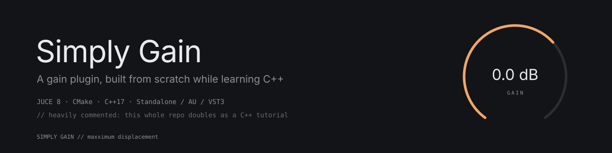

<p align="center">
  <a href="#quick-start">Quick start</a> &nbsp;·&nbsp;
  <a href="#an-overview">Overview</a> &nbsp;·&nbsp;
  <a href="#key-features">Features</a> &nbsp;·&nbsp;
  <a href="#build-from-source">Build from source</a> &nbsp;·&nbsp;
  <a href="#documentation">Documentation</a> &nbsp;·&nbsp;
  <a href="#status">Status</a> &nbsp;·&nbsp;
  <a href="#contributing">Contributing</a> &nbsp;·&nbsp;
  <a href="#licence">Licence</a>
</p>

<p align="center">
  <a href="https://github.com/milliedavidson/simply-gain/releases/latest/download/simply-gain-0.1.0-mac.zip"></a>
  <a href="https://github.com/milliedavidson/simply-gain/releases/latest/download/simply-gain-0.1.0-windows.zip"></a>
  <a href="https://github.com/milliedavidson/simply-gain/releases/latest/download/simply-gain-0.1.0-linux.tar.gz"></a>
  <br>
  <a href="https://github.com/milliedavidson/simply-gain/releases/latest"></a>
</p>

<p align="center">
  
  
  
  
  
</p>

---

## Quick start

**Simply Gain is a free volume knob for your DAW.** Put it on a track, a bus or your whole mix and
turn the ring. That's the whole plugin.

It runs on **macOS, Windows and Linux**, as a **VST3** in Ableton Live, Reaper and most other DAWs,
and as an **Audio Unit** in Logic Pro and GarageBand on the Mac.

### 1. Download

Go to the [**Releases page**](https://github.com/milliedavidson/simply-gain/releases/latest), find
the file for your system under **Assets**, and download it.

| Your system                                   | Download                                                                                                                                  | What's inside             |
|-----------------------------------------------|-------------------------------------------------------------------------------------------------------------------------------------------|---------------------------|
| **macOS** 11 or later, Intel or Apple Silicon | [`simply-gain-0.1.0-mac.zip`](https://github.com/milliedavidson/simply-gain/releases/latest/download/simply-gain-0.1.0-mac.zip)           | Audio Unit and VST3       |
| **Windows** 10 or later, 64-bit               | [`simply-gain-0.1.0-windows.zip`](https://github.com/milliedavidson/simply-gain/releases/latest/download/simply-gain-0.1.0-windows.zip)   | VST3 and a standalone app |
| **Linux**, 64-bit Intel/AMD                   | [`simply-gain-0.1.0-linux.tar.gz`](https://github.com/milliedavidson/simply-gain/releases/latest/download/simply-gain-0.1.0-linux.tar.gz) | VST3 and a standalone app |

Each download also has a short installation note and the licences. The Mac version is the one I
build and test myself. The Windows and Linux versions are built automatically by GitHub, so if
something's off on your machine, please [tell me](https://github.com/milliedavidson/simply-gain/issues).

### 2. Install it

<details open>
<summary><b>macOS</b></summary>

<br>

**Copy it where your DAW looks.** Unzip, then in Finder choose **Go → Go to Folder…** (`⇧⌘G`),
paste the folder for your DAW and press Return, and drag the plugin in.

| Your DAW                             | Plugin to copy          | Folder to paste                       |
|--------------------------------------|-------------------------|---------------------------------------|
| **Logic Pro**, **GarageBand**        | `simply gain.component` | `~/Library/Audio/Plug-Ins/Components` |
| **Ableton Live**, **Reaper**, others | `simply gain.vst3`      | `~/Library/Audio/Plug-Ins/VST3`       |

**Tell macOS it's safe.** macOS blocks plugins downloaded from the internet unless Apple has
checked them. Simply Gain hasn't been through that yet (it needs a paid Apple Developer ID, which
is on the [to-do list](#status)). Open **Terminal** (Applications → Utilities), paste the line for
the plugin you copied, and press Return. Nothing is printed when it works.

```bash
# Audio Unit
xattr -dr com.apple.quarantine ~/Library/Audio/Plug-Ins/Components/"simply gain.component"

# VST3
xattr -dr com.apple.quarantine ~/Library/Audio/Plug-Ins/VST3/"simply gain.vst3"
```

> The command only removes the "downloaded from the internet" flag from that one plugin. If you'd
> rather not trust a download, [build it yourself](#build-from-source): the whole source is here.

</details>

<details>
<summary><b>Windows</b></summary>

<br>

**Unblock the zip first.** Windows marks files from the internet as untrusted and passes that on to
everything inside a zip. Right-click the `.zip`, choose **Properties**, tick **Unblock** at the
bottom of the General tab, click **OK**, and then unzip it. (No Unblock box? Then it's already fine.)

**Copy the plugin.** Copy the whole `simply gain.vst3` folder into:

```text
C:\Program Files\Common Files\VST3
```

Windows will ask for permission to copy there. Choose **Continue**.

**The standalone app** needs no installing: double-click `simply gain.exe`. Windows may say
"Windows protected your computer", because the app isn't signed with a paid certificate yet. Click
**More info**, then **Run anyway**.

</details>

<details>
<summary><b>Linux</b></summary>

<br>

Built on Ubuntu 22.04, so most distributions from 2022 onwards should run it. On an older one,
[build it from source](#build-from-source).

**Copy the plugin.** Extract the archive, open a terminal in the new folder and run:

```bash
mkdir -p ~/.vst3
cp -r "simply gain.vst3" ~/.vst3/
```

To install it for every user instead, copy the folder into `/usr/lib/vst3` with `sudo`.

**The standalone app** needs no installing. In the same folder:

```bash
chmod +x "simply gain"
./"simply gain"
```

</details>

### 3. Open your DAW

- **Logic Pro** checks new plugins as it starts. Find it in any channel strip's **Audio FX** slot
  under **Audio Units → Maxximum Displacement → simply gain**.
- **Other DAWs**: rescan your plugins if it doesn't appear straight away. It's listed under
  **Maxximum Displacement**.

<details>
<summary><b>It didn't show up, or Logic says it failed</b></summary>

<br>

- **macOS:** check you ran the `xattr` line for the plugin your DAW is using. In Logic, open
  **Logic Pro → Settings → Plug-in Manager**, select **simply gain** and click
  **Reset & Rescan Selection**.
- **Windows:** check you copied the whole `simply gain.vst3` folder, and that you unblocked the zip
  before unzipping it.
- **Linux:** check the folder is at `~/.vst3/simply gain.vst3` and that your DAW scans `~/.vst3`.
- Still stuck? [Open an issue](https://github.com/milliedavidson/simply-gain/issues) and tell me
  your DAW and operating system version.

</details>

### Using it

- **Turn the ring** clockwise for louder, anticlockwise for quieter.
- **Drag the number** for fine changes, or **click it** and type an exact value like `-3` or `2.5`.
- **Double-click the ring** to go back to 0 dB. **0 dB means no change.**
- The range is **-60 to +30 dB**. The arc warms from apricot to amber as you push hard.

There's a fuller guide, from "like you're five" to "for the nerds", behind the **?** button in the
plugin, and in [`guide/quick-start.md`](guide/quick-start.md).

<div align="right">[ <a href="#quick-start">↑ Back to top ↑</a> ]</div>

---

## An overview

Simply Gain is also a **test / learning project**, not a polished product. I'm a C# developer
teaching myself C++ and audio DSP, one plugin at a time. Gain is deliberately the simplest
possible starting point: the actual signal processing is one multiply. All the real learning is in
the *architecture*. That means how a plugin talks to a host, how the audio thread's rules differ
from everything else you've written, and what C++ is doing that C# quietly does for you.

Because of that, **the code is closer to a tutorial than production source**. Every C++ construct
gets a "what this is / why it's here" note, often with a C# comparison, and the full reasoning
lives in [`documentation/`](documentation/README.md). If you're coming from a managed language and
finding your footing in C++ or audio programming, I hope this is useful. There aren't nearly
enough audio programming resources out there, so maybe this fills a tiny gap.

**Fork it, strip it down, build on top of it, learn from it.** The licence terms are in
[Licence](#licence). And if you spot something wrong or have a better way to do it, I'd love to
hear it: see [Contributing](#contributing).

<div align="right">[ <a href="#quick-start">↑ Back to top ↑</a> ]</div>

---

## Key features

- **One CMake project, three formats**: Standalone, Audio Unit (AU) and VST3.
- **A [quick-start guide](guide/quick-start.md) built into the plugin**, behind the **?** button.
- **AU validated end to end** with Apple's own `auval`, so Logic and GarageBand will load it.
- **Commented for people learning C++**: short notes in the code, with the full reasoning in
  [`documentation/`](documentation/README.md) rather than crowding the source.
- **Explains *why*, not just what**: real-time constraints, thread safety, dB vs linear gain.
- **IDE-agnostic**: CLion, VS Code, Xcode and Visual Studio all work from the same
  `CMakeLists.txt`.

<div align="right">[ <a href="#quick-start">↑ Back to top ↑</a> ]</div>

---

## Build from source

Want to read it, change it, or don't trust a download? Everything below is for you.


### 1. Clone the repository, including the JUCE submodule

JUCE is vendored as a git submodule rather than committed directly, so `--recurse-submodules`
is essential. Skip it and `libs/JUCE` will be empty, which produces a confusing CMake error
rather than an obvious one.

```bash
git clone --recurse-submodules https://github.com/milliedavidson/simply-gain.git
```

### 2. Build

Either open the folder in **CLion** (it detects the CMake project automatically: pick the
`SimpleGain_Standalone` target and hit Run), or from the terminal:

```bash
cmake -B build -DCMAKE_BUILD_TYPE=Debug
cmake --build build --target SimpleGain_Standalone -j 8
```

The first configure builds JUCE's `juceaide` helper tool and takes about 90 seconds. After that,
builds are incremental.

**On Windows or Linux?** The same CMake commands work, with a few differences:

- **Windows:** you need Visual Studio 2022 with the "Desktop development with C++" workload.
  Add `--config Release` (or `Debug`) to the build command, because Visual Studio picks the
  configuration at build time.
- **Linux:** you need a compiler, CMake and JUCE's development libraries. On Ubuntu or Debian:

```bash
sudo apt-get install build-essential cmake libasound2-dev libfreetype-dev libfontconfig1-dev \
  libx11-dev libxcomposite-dev libxcursor-dev libxext-dev libxinerama-dev libxrandr-dev \
  libxrender-dev libglu1-mesa-dev mesa-common-dev
```

- **Both:** the AU format is macOS-only, so build `SimpleGain_VST3` instead of `SimpleGain_AU`.

### 3. Run it

```bash
open "build/SimpleGain_artefacts/Debug/Standalone/simply gain.app"
```

That's the Mac command. On Windows run `simply gain.exe` from the same `Standalone` folder, and on
Linux run `simply gain`.

The Standalone build is the fast development loop: a real app you can run without a DAW, with
its own Audio/MIDI settings (**Options → Audio/MIDI Settings**) for picking an input and output
device.

### 4. Build the plugin formats and validate

```bash
cmake --build build --target SimpleGain_AU SimpleGain_VST3 -j 8
```

`COPY_PLUGIN_AFTER_BUILD` installs both automatically to `~/Library/Audio/Plug-Ins/Components` and
`~/Library/Audio/Plug-Ins/VST3`. To check the AU the same way Logic will before it loads it:

```bash
auval -v aufx Sgai Mxdp
```

### 5. Run the tests

```bash
cmake --build build --target check
```

This builds a test app that drives the real processor with no DAW and no sound card, then runs
it. The first build compiles JUCE a second time, so it takes a few minutes; the plugin build
doesn't touch it.

### 6. Package it to send to someone

```bash
scripts/package-mac.sh
```

This makes `dist/simply-gain-<version>-mac.zip`: a Release build for Intel and Apple Silicon Macs,
macOS 11 and later, with an install note. That's the file attached to each
[release](https://github.com/milliedavidson/simply-gain/releases). It isn't signed with an Apple
Developer ID yet, which is why the install note includes one Terminal command. See
[Identity & macOS §6](documentation/plugin-identity-and-macos.md#6-sending-it-to-someone-universal-builds-signing-and-gatekeeper).

The Windows and Linux downloads aren't built by hand. When a release is published, a GitHub Actions
workflow builds both and attaches them to it. See
[CI & GitHub Actions §4](documentation/ci-and-github-actions.md#4-the-release-builds-windows-and-linux).

<div align="right">[ <a href="#quick-start">↑ Back to top ↑</a> ]</div>

---

## Documentation

The code stays light (-ish) on comments; the reasoning lives in
**[`documentation/`](documentation/README.md)**. Each doc opens with an "In short" summary, then
goes deep.

| Doc                                                                         | What's in it                                                                                   |
|-----------------------------------------------------------------------------|------------------------------------------------------------------------------------------------|
| **The plugin**                                                              |                                                                                                |
| [The plan](documentation/plan.md)                                           | The phased build, start to finish                                                              |
| [Hosting & threads](documentation/plugin-hosting-and-threads.md)            | Why the DAW owns `main()`, the audio thread's deadline, samples vs blocks                      |
| [Parameters & automation](documentation/parameters-and-automation.md)       | APVTS, dB vs linear gain, skew, thread-safe parameter reads                                    |
| [Smoothing & the audio loop](documentation/smoothing-and-the-audio-loop.md) | Zipper noise and `SmoothedValue`, loop order, raw pointers, denormals                          |
| [State: save and restore](documentation/state-save-and-restore.md)          | What a host stores, `ValueTree` → XML → bytes, loading untrusted data safely                   |
| [Identity & macOS](documentation/plugin-identity-and-macos.md)              | Bundle IDs, 4-character codes, `auval`, privacy permissions, packaging and signing             |
| [The editor (GUI)](documentation/editor-gui.md)                             | Components, the two-way `SliderAttachment`, member order, layout, testing a GUI with no screen |
| **C++ foundations**                                                         |                                                                                                |
| [Memory model](documentation/cpp-memory-model.md)                           | Stack vs heap, references vs pointers, RAII vs garbage collection                              |
| [Build pipeline](documentation/cpp-build-pipeline.md)                       | Headers, preprocessor, compiling and linking, vs Roslyn and the CLR                            |
| [CMake walkthrough](documentation/cmake-walkthrough.md)                     | `CMakeLists.txt` line by line, and why Debug builds matter for audio                           |
| **Workflow**                                                                |                                                                                                |
| [Dev tooling](documentation/dev-workflow-and-tooling.md)                    | CLion, CMake generators, Ninja, git submodules                                                 |
| [Testing](documentation/testing.md)                                         | The automated tests, and how to hear it standalone and in a DAW                                |
| [CI & GitHub Actions](documentation/ci-and-github-actions.md)               | What the pipeline does, and why the default template didn't work                               |

If you have any suggestions or feedback, see [Contributing](#contributing).

<div align="right">[ <a href="#quick-start">↑ Back to top ↑</a> ]</div>

---

## Status

Built one verified phase at a time. Nothing below is marked done unless it's actually been built
and run.

- [x] Project scaffold: CMake, JUCE 8 as a submodule, no Projucer
- [x] `AudioProcessor` skeleton: pass-through audio, proves the toolchain end to end
- [x] Standalone, AU and VST3 all building
- [x] AU validated with `auval`
- [x] macOS microphone/Bluetooth privacy permissions (TCC) handled correctly
- [x] An actual gain parameter (`AudioProcessorValueTreeState`), host-automatable, −60 to +30 dB
- [x] Sample-accurate gain smoothing (no zipper noise): biggest per-sample gain step down 960× in testing
- [x] State save/restore: the gain survives closing and reopening a project, and corrupt data can't crash it
- [x] Automated tests: `cmake --build build --target check`, run on every push
- [x] A real GUI: a resizable knob editor in the Maxximum Displacement brand look, two-way bound to the parameter, tested without a screen
- [x] Universal binary (Apple Silicon + Intel), packaged as a zip with `scripts/package-mac.sh`
- [ ] Windows and Linux downloads: built by GitHub Actions when a release is published, not yet run in a DAW
- [ ] Signed and notarised installer (needs an Apple Developer ID)

<div align="right">[ <a href="#quick-start">↑ Back to top ↑</a> ]</div>

---

## Built with Claude AI

Full disclosure: I'm building this in collaboration with [Claude](https://claude.ai),
Anthropic's AI assistant. I'm designing, reviewing and steering every step and Claude is writing code alongside me, explaining the C++ and JUCE concepts
as we go and speeding up development time.

<div align="right">[ <a href="#quick-start">↑ Back to top ↑</a> ]</div>

---

## Contributing

Spotted a bug or a better way to do something? I'd love to know. No software is 100% perfect, but
I strive to get as close as possible 🙂

- **Comment on a line, open an [issue](https://github.com/milliedavidson/simply-gain/issues) or a PR**

<div align="right">[ <a href="#quick-start">↑ Back to top ↑</a> ]</div>

---

## Licence

| What                                | Licence                                                                                                                                      |
|-------------------------------------|----------------------------------------------------------------------------------------------------------------------------------------------|
| Simply Gain's own source code       | [MIT](LICENSE)                                                                                                                               |
| JUCE, the framework it's built on   | [AGPLv3](https://www.gnu.org/licenses/agpl-3.0.en.html) (JUCE is dual-licensed with a commercial licence; this project uses the AGPLv3 side) |
| The finished plugin you download    | Includes JUCE, so it's distributed under the **AGPLv3**: the complete source is this repository                                              |
| Inter, JetBrains Mono, Sora (fonts) | [SIL Open Font License 1.1](assets/fonts/)                                                                                                   |
| VST3 SDK and Audio Unit SDK         | MIT and Apache 2.0, with their notices in the download's `Licences` folder                                                                   |

In plain words: you're free to use the plugin and to read, fork and learn from the code. My own
code is MIT, so you can reuse it freely. If you build on it or share the compiled plugin, JUCE's
AGPLv3 terms apply to the result: see [`libs/JUCE/LICENSE.md`](libs/JUCE/LICENSE.md). The names
"Simply Gain" and "Maxximum Displacement" are not covered by any of these licences.

---

<p align="center"><code>SIMPLY GAIN // maxximum displacement</code></p>

<div align="right">[ <a href="#quick-start">↑ Back to top ↑</a> ]</div>
