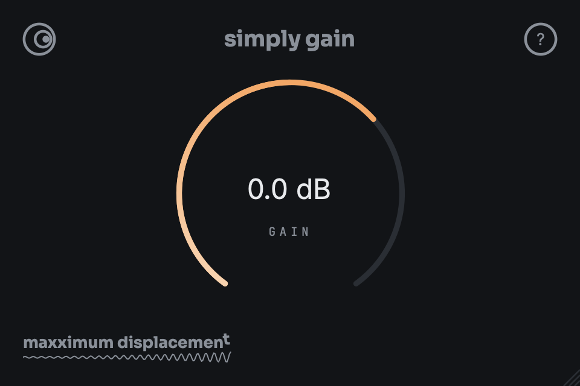
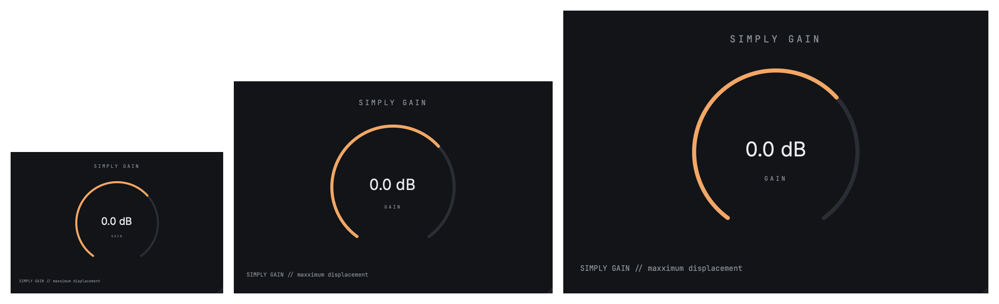
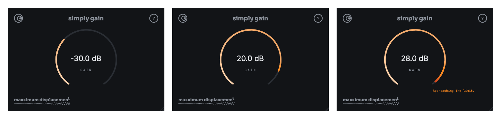
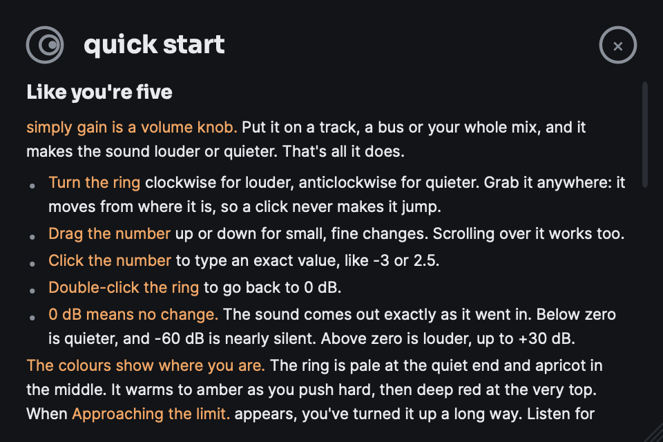

# The editor (GUI)

How the plugin window is built. It covers what an editor is, how the knob is wired to the
parameter in both directions, why member order matters, and how a GUI gets tested with no screen.

**Simply Gain docs** · [Index](README.md)  
**The plugin:** [Plan](plan.md) · [Hosting & threads](plugin-hosting-and-threads.md) · [Parameters & automation](parameters-and-automation.md) · [Smoothing & the audio loop](smoothing-and-the-audio-loop.md) · [State: save and restore](state-save-and-restore.md) · [Identity & macOS](plugin-identity-and-macos.md) · **The editor (GUI)**  
**C++ foundations:** [Memory model](cpp-memory-model.md) · [Build pipeline](cpp-build-pipeline.md) · [CMake walkthrough](cmake-walkthrough.md)  
**Workflow:** [Dev tooling](dev-workflow-and-tooling.md) · [Testing](testing.md) · [CI & GitHub Actions](ci-and-github-actions.md)

---

## In short

- **The editor is a `juce::Component`** — JUCE's base class for anything drawable, roughly WPF's
  `UIElement` or WinForms' `Control`. Components form a tree: the editor owns a title, a knob, a
  limit readout and the brand logo.
- **It's separate from the processor and optional.** A host can run the plugin with no window,
  and opens and closes the window many times. The editor lives on the **message thread**;
  `processBlock` stays on the audio thread and never learns the editor exists.
- **`SliderAttachment` is a two-way binding**, the closest thing JUCE has to WPF data binding.
  Turn the knob and the parameter moves; the host automates the parameter and the knob moves.
  We write no listener code ourselves.
- **Member order is a correctness rule.** C++ destroys members in reverse order of declaration,
  and the attachment's destructor touches the slider, so the attachment is declared *after* the
  slider. The look-and-feel goes *first*, so it outlives everything that uses it.
- **`paint()` draws, `resized()` positions.** JUCE calls both; we never do. Every size is a
  fraction of the window, so the whole layout scales.
- **The window is 480×320**, the plugin family's smallest size, and resizes up to 200%, always
  keeping its 3:2 shape.
- **The knob follows the pointer round its arc, but a click never moves it.** JUCE's styles do
  one or the other, so a small subclass of `juce::Slider` adapts JUCE's circular style. The number
  in the middle is a fine slider: drag it up or down, 0.05 dB a pixel, or click it to type.
- **A `LookAndFeel` is JUCE's theme.** Ours carries the three brand fonts, draws the knob and puts
  the value inside the ring. It has to be set *after* the children are added, and detached again in
  the destructor.
- **The look comes from the Maxximum Displacement brand plan**: a flat near-black panel, a slim
  ring, one accent colour (apricot) and a big value in the middle. The arc is lighter at the quiet
  end. Around 85% of the range it warms to Volcanic Amber, the brand's colour for "approaching the
  limit", and around 95% to a deep red-orange. Then *Approaching the limit.* fades in by the end of
  the arc. Each colour blends into the next, with no hard edges.
- **The name is in the logo's font**, Sora Bold. The brand logo itself, with its growing wave,
  sits bottom left, and the ring mark top left. Click the ring mark and a panel says the website is
  under construction.
- **The ? button, top right, opens a quick-start guide** over the controls. Its text is a Markdown
  file compiled into the plugin, so it works offline, with a link to these docs at the end.
- **It's tested without a screen.** JUCE can build a component, lay it out and paint it into an
  image in memory. 45 tests cover it, and a `--snapshots` mode writes the PNGs on this page.
- **Nothing permanent changed.** The parameter id, range and saved format are untouched; the
  editor only *reads and writes* the parameter.



---

## 1. What an editor is

Until Phase 6 the plugin showed JUCE's `GenericAudioProcessorEditor`: an automatically generated
window with one slider per parameter. It works, but it looks like a debugging tool. Phase 6
replaces it with our own `SimpleGainAudioProcessorEditor`.

An editor is a **`juce::Component`**. Everything visible in a JUCE app is one: windows, buttons,
sliders, labels. Components nest, so the window is a tree:

```
SimpleGainAudioProcessorEditor     (the window, which paints the background)
├── title                          (a juce::Label: simply gain)
├── gainSlider                     (a juce::Slider, which owns its own value text box)
├── limitReadout                   (a FadingLabel: Approaching the limit.)
├── logo                           (a Wordmark: the brand logo)
├── guide                          (a GuideView: the quick start, hidden until opened)
├── websitePanel                   (a WebsitePanel: "Under construction", hidden until opened)
├── guideButton                    (a GuideButton: the ? in the top-right corner)
└── markButton                     (a MarkButton: the ring mark in the top-left corner)
```

| JUCE                        | WPF                              | WinForms               |
|-----------------------------|----------------------------------|------------------------|
| `juce::Component`           | `UIElement` / `FrameworkElement` | `Control`              |
| `addAndMakeVisible (child)` | adding to `Children`             | `Controls.Add (child)` |
| `paint (Graphics&)`         | `OnRender`                       | `OnPaint`              |
| `resized()`                 | `ArrangeOverride`                | `OnResize` / `Layout`  |
| `juce::Slider`              | `Slider`                         | `TrackBar`             |

Two things differ from what a C# developer expects:

- **There's no designer and no markup.** The layout is code. For a window this size that's
  shorter than the XAML would be, and it's what almost every plugin does.
- **JUCE draws everything itself**, rather than asking the operating system for native buttons.
  That's why the plugin looks identical in Logic, Reaper and the Standalone app, and why we can
  paint exact brand colours and our own knob with a few lines.

---

## 2. The editor and the processor

The editor is **not** part of the processor, and the processor doesn't need it:

- A host can create the plugin and process audio without ever opening a window. Some never do.
- A host can open and close the window many times in one session. Each open creates a *new*
  editor (`createEditor()`) and each close destroys it. The processor, and its parameter, outlive
  all of them.
- The editor runs on the **message thread** (the GUI thread). `processBlock` runs on the audio
  thread. They share only the *parameter*, which is built for exactly that (see
  [Parameters & automation](parameters-and-automation.md)), so the editor never needs a lock the
  audio thread could wait on.

The constructor takes the processor **by reference**:

```cpp
explicit SimpleGainAudioProcessorEditor (SimpleGainAudioProcessor&);
```

A reference can't be null, and taking one says "I use this but don't own it". The processor
always outlives the editor, so there's nothing to delete. The base class
`AudioProcessorEditor` remembers the processor itself (as a member called `processor`), so we
don't keep a second copy. The tests don't touch that member: they find the knob by its ID instead.

`explicit` stops C++ from quietly converting a processor into an editor wherever one is
expected. C# has no direct equivalent because it has no implicit single-argument constructor
conversions; in C++ you opt out of them with `explicit`.

---

## 3. The knob and the title

```cpp
title.setText (p.getName().toLowerCase(), juce::dontSendNotification);

gainSlider.setComponentID ("gainSlider");
gainSlider.setTitle ("Gain");
gainSlider.setTextBoxStyle (juce::Slider::TextBoxBelow, false, 0, 0);    // getSliderLayout() places it
```

- **The title** is the product name in lower case, in the logo's font, Sora Bold (section 9).
  `getName()` returns `JucePlugin_Name`, which CMake makes from `PRODUCT_NAME`, so the window, the
  host's plugin list and the bundle names can't disagree. Renaming the plugin is one line in
  `CMakeLists.txt`.
- **The knob** is a `juce::Slider` drawn as a rotary knob. You turn it by dragging round it, and
  how that works without the value jumping on a click is section 10.
- **The text box** shows the value in the middle of the ring, and you click it to type a number.
  The `false` means it's *not* read-only. "Below" and the two zeros don't matter: the look-and-feel
  decides where the box goes (section 9).
- **Colours** are the brand plan's tokens, set once in a `tokens` namespace in
  `Source/Brand.h`, which everything that draws includes. `setColour` takes an *ID* (such as `textBoxTextColourId`) so each part can be
  styled separately. The knob's own colours are used directly in its drawing code (section 13), so
  they need no IDs.
- **`setComponentID ("gainSlider")`** gives the knob a name the tests can look it up by,
  without needing access to the editor's private members.
- **`setTitle ("Gain")`** is what a screen reader announces. It costs one line and makes the
  knob usable by people who can't see it. It's also the "GAIN" caption under the value.

Nothing here says *what the knob's range is*, or what text it shows. That comes from the
parameter, via the attachment in the next section.

---

## 4. The attachment: a two-way binding

This is the heart of the editor, and it's **one line**:

```cpp
gainAttachment (p.apvts, "gain", gainSlider)
```

`AudioProcessorValueTreeState::SliderAttachment` connects a slider to a parameter by id. After
it runs:

| Event                            | What happens                                                                                                        |
|----------------------------------|---------------------------------------------------------------------------------------------------------------------|
| The knob starts                  | It's moved to the parameter's current value, not the default.                                                       |
| The user turns the knob          | The parameter is set, and the host is told it's being edited, so a recording automation lane captures the movement. |
| The user double-clicks the knob  | It resets to the parameter's default, 0 dB.                                                                         |
| The user types `-12` in the box  | It's parsed with the *parameter's* text rules and applied.                                                          |
| The host automates the parameter | The knob moves to match.                                                                                            |

The attachment also **replaces the slider's own range and text functions with the parameter's**.
That's why the box reads `−6.0 dB`, not `-6` — the text lambda from
[Parameters & automation](parameters-and-automation.md) is reused, and the knob covers
−60...+30 dB without our repeating those numbers in the editor. The range exists in exactly one
place.

**C# comparison.** This is WPF data binding with `Mode=TwoWay`:

```xml
<Slider Value="{Binding Gain, Mode=TwoWay}" Minimum="-60" Maximum="30" />
```

Same idea: the view and the model stay in sync without hand written event handlers. The
difference is that here it's an object you construct, not markup, and it has to be kept *alive* for
the binding to hold (the next section).

**Threads.** The host may change the parameter from any thread, but a component may only be
touched on the message thread. The attachment handles this: if the change arrives on another
thread, it posts an asynchronous update and the knob moves on the message thread. We never
write that code ourselves — which is exactly why we use the attachment.

---

## 5. Member order matters

The members are declared in this order:

```cpp
SimpleGainLookAndFeel lookAndFeel;
juce::Label title;
RelativeRotarySlider gainSlider;
FadingLabel limitReadout;
Wordmark logo { lookAndFeel };
GuideView guide { lookAndFeel };
WebsitePanel websitePanel { lookAndFeel };
GuideButton guideButton { lookAndFeel };
MarkButton markButton { lookAndFeel };
juce::AudioProcessorValueTreeState::SliderAttachment gainAttachment;
```

C++ **constructs members top to bottom in declaration order, and destroys them bottom to top**
— regardless of the order in the constructor's initialiser list. So here:

```
construct:  lookAndFeel → title → gainSlider → limitReadout → logo → gainAttachment
destroy:    gainAttachment → logo → limitReadout → gainSlider → title → lookAndFeel
```

That's right, because of what each part does:

- The look-and-feel (section 9) is used by the widgets, so it has to be built before them and
  destroyed after them. The logo even holds a reference to it, to get its font.
- The attachment's *constructor* uses the slider, so the slider has to exist first.
- The attachment's *destructor* calls `slider.removeListener (this)`. If the slider were already
  gone, that would touch freed memory — a use-after-free, the bug described in
  [Memory model](cpp-memory-model.md).

Swap the two lines and it compiles without a warning. It may even run, until the editor is
closed. That's the nasty part: **nothing flags the mistake**, so the header carries a comment in
capitals and the tests open and close editors 50 times.

**C# comparison.** There's nothing like it. In C#, objects are never destroyed in a defined
order — the garbage collector decides — and you can't hold a dangling reference. In C++ the
order is defined and *you* are responsible for it. The same rule is why a `std::unique_ptr`
member is safe to declare next to the thing it owns: the destructors run in a known sequence.

---

## 6. `paint()`: drawing the background

```cpp
g.fillAll (tokens::base);
```

JUCE calls `paint` whenever part of the window needs redrawing: the first time, after a resize,
after something moves. **We never call it ourselves.** To ask for a redraw you'd call
`repaint()`, which schedules one.

`juce::Graphics` is the drawing context — WinForms' `Graphics`, or a WPF `DrawingContext`. The
editor paints only the background; **children paint themselves**, and JUCE draws them on top
afterwards. Everything else, from the title to the corner buttons, is a child.

- **The background is flat**: one colour, Base (`#121417`), shared by every plugin in the family.
  No gradient and no glow, as the brand plan asks.
- **The ring mark** used to be painted here too. It's now a button that draws itself (section 16).

`paint` can run many times a second while the window is dragged, so it should be cheap and
shouldn't allocate much. Ours fills one colour.

---

## 7. `resized()`: layout by carving up a rectangle

JUCE has no layout panels like WPF's `Grid` or `StackPanel`. You work out each child's rectangle
yourself. A common idiom is to hold a `juce::Rectangle` and **slice pieces off it** with
`removeFromTop (n)`, which *returns* the top `n` pixels and shrinks the rectangle by that much.

This window is simple enough to place things directly, as fractions of its height:

```cpp
const auto height = static_cast<float> (getHeight());

title.setBounds (juce::Rectangle<float> (0.0f, height * 0.05f, width, height * 0.1f).toNearestInt());

const auto knobSize = height * 0.64f;
gainSlider.setBounds (juce::Rectangle<float> (knobSize, knobSize).withCentre (getLocalBounds().getCentre().toFloat()).toNearestInt());

const auto knobArea = gainSlider.getBounds().toFloat();
const auto arcEnd = knobArea.getCentre().getPointOnCircumference (SimpleGainLookAndFeel::ringRadius (knobArea),
                                                                   gainSlider.getRotaryParameters().endAngleRadians);
limitReadout.setBounds (juce::Rectangle<float>::leftTopRightBottom (arcEnd.x, height * 0.775f, width - margin, height * 0.825f).toNearestInt());
```

- **The title** is a strip near the top, the full width, with the name centred.
- **The knob** is a square, 64% of the height, centred in the window. The ring ends up about the
  same size, relative to the window, as in the brand plan's mock-up.
- **The readout** starts just under the end of the arc, at the bottom right, and runs right. That's
  where the cursor is when you turn up to the limit. `getPointOnCircumference` finds the arc's end
  from the knob's end angle, so it stays in place at every size. The label's border is set to none,
  so its text starts exactly there.
- **The logo** is a strip along the bottom left, half the width, as far from the bottom as the
  ring mark is from the left.
- **The corner buttons** mirror each other: the ring mark top left and the ? top right, the same
  size, the same distance from their edges, and level with the title's letters.

`getLocalBounds()` is the component's own area with its top-left at (0, 0); `getBounds()` would
be relative to its parent. JUCE calls `resized()` when the size first changes and on every later
resize. Because every number is a **fraction of the window**, the layout works at any size without
special cases. Absolute pixel sizes would look right at one size and wrong at all the others.

**Floats, then round once.** The sums are done in `float` and `toNearestInt()` rounds the finished
rectangle to whole pixels. Rounding each part separately would let small errors add up.

**Don't keep pointers to a child JUCE owns.** An earlier version called
`gainSlider.setTextBoxStyle (...)` here with new sizes. When a size changes, JUCE deletes the
box's `Label` and builds a new one, so anything still pointing at the old label is left dangling.
A test did exactly that, and crashed about one run in four (the story is in
[Testing](testing.md#how-i-know-they-can-fail)). The box is now placed by the look-and-feel
instead, so resizing no longer rebuilds it. The rule still stands: look a JUCE-owned child up
again, or use `juce::Component::SafePointer`, which becomes null when its component is deleted
(like C#'s `WeakReference`).

---

## 8. Making the window resizable

```cpp
setResizable (true, true);
setResizeLimits (defaultWidth, defaultHeight, defaultWidth * 2, defaultHeight * 2);
getConstrainer()->setFixedAspectRatio (static_cast<double> (defaultWidth) / defaultHeight);
setSize (defaultWidth, defaultHeight);
```

- `setResizable (true, true)` lets the *host* resize the window and also adds a small drag
  handle in the bottom-right corner. The look-and-feel draws it quietly, in the track's colour,
  brightening while the mouse is on it.
- **480×320 is both the opening size and the smallest.** There's no standard size for a plugin
  window: hosts accept whatever the plugin asks for. The brand plan picks 480×320 as the smallest
  window for the whole family, so every plugin opens looking alike. Smaller than that and the text
  stops being readable.
- **The largest is 200%**, 960×640. Larger is wasted on a single knob.
- **The fixed aspect ratio** keeps the window 3:2, like the plan's mock-ups. A free-form resize
  would give a tall thin strip or a wide flat one, and the knob would have nowhere sensible to go.
- **`static_cast<double>`** matters: `defaultWidth / defaultHeight` is *integer* division and
  would give `1`, not 1.5. Casting one side first makes it a real division. (C# does the same with
  `int / int`, so there too you'd cast one side.)
- **`setSize` comes last**, after the limits are set, so the opening size is checked against
  them.



Not every host honours these limits (some plugin hosts fix the window size). The editor stays
correct either way, because `resized()` copes with whatever size it's handed.

---

## 9. A look-and-feel: the brand fonts and the value text

JUCE draws every widget through a **`LookAndFeel`**: one object holding the drawing code for
buttons, sliders, labels and so on, like a theme or a WPF `Style`/`ControlTemplate`. You change
how something looks by subclassing `LookAndFeel_V4` (JUCE's modern default) and overriding only the
parts you want. Everything we don't override keeps JUCE's default look.

| Override              | What it does                                                       | Section |
|-----------------------|--------------------------------------------------------------------|---------|
| `getLabelFont`        | The value text in Inter, sized to its box                          | this    |
| `createSliderTextBox` | Builds the value box so clicks pass through it to the knob         | 10      |
| `getSliderLayout`     | Puts the value box in the middle of the ring                       | 13      |
| `drawRotarySlider`    | Draws the track, the arc and the caption                           | 13      |
| `drawCornerResizer`   | Draws the resize grip in the track's colour instead of bright grey | 8       |

It also hands out the fonts, `textFont`, `monoFont` and `logoFont`, to everything that draws text.

### The brand fonts, built into the plugin

The brand plan uses **Inter** for text and **JetBrains Mono** for readouts and the brand line. The
logo is set in **Sora Bold**, so the title and the logo use that. A plugin can't rely on a font being
installed on the user's machine, so all three are compiled in.
CMake's `juce_add_binary_data` turns each `.ttf` in `assets/fonts/` into a byte array in a
generated `BinaryData` namespace. (The guide's text is compiled in the same way, section 15.)

```cpp
inter (juce::Typeface::createSystemTypefaceFor (BinaryData::InterRegular_ttf,
                                                BinaryData::InterRegular_ttfSize))
```

`createSystemTypefaceFor` registers the font from memory and returns a `Typeface::Ptr`. That's a
reference-counted pointer: the font lives as long as something points at it, much like a C#
object reference. The look-and-feel keeps one for each font and hands out
`juce::FontOptions (inter).withHeight (h)` wherever text is drawn.

All three are under the **SIL Open Font License**, which allows embedding them in software. The
licence files sit beside the fonts in `assets/fonts/`.

### The value text scales with its box

```cpp
juce::Font SimpleGainLookAndFeel::getLabelFont (juce::Label& label)
{
    if (dynamic_cast<juce::Slider*> (label.getParentComponent()) != nullptr)
        return textFont (static_cast<float> (label.getHeight()) * 0.68f);

    return LookAndFeel_V4::getLabelFont (label);
}
```

JUCE asks this every time it draws a label, and when a person starts typing into the box.

- **The font is a fixed share of the box's height.** The box is a fraction of the ring, which is a
  fraction of the window. So the text scales with the window *and can never overflow its box*,
  with no separate font-size maths to keep in step with the layout.
- **It only touches the knob's box.** A slider's value box is a `Label` whose parent is the slider,
  which is what `dynamic_cast` checks. `dynamic_cast<Slider*>` is C++'s `as`: it gives the
  pointer back if the object really is that type and `nullptr` if not (C#: `label.Parent as Slider`).
  Every other label, including the limit readout, falls through to the base class.

### Three rules, and the compiler enforces none of them

1. **It must outlive everything that uses it.** `setLookAndFeel (&lookAndFeel)` stores a *pointer*;
   the editor doesn't own it, and JUCE says so in the function's documentation. So the
   look-and-feel is a member declared first (section 5).
2. **Set it after the children are added.** Some widgets build their parts when they first get a
   look-and-feel. The slider builds its value box with `createSliderTextBox`, and JUCE only
   rebuilds it when the look-and-feel *changes*, not when the slider is added to a window. Set it
   first and the knob keeps a box built by JUCE's default theme, which catches clicks. A test of
   clicking the number found this.
3. **Detach it in the destructor.** `setLookAndFeel (nullptr)` runs while the children still exist.
   Skip it and JUCE's own destructor assertion fires: *"you tried to delete a LookAndFeel while
   something is still using it"*. That assertion is only a log message in a Debug build, so by
   default no test fails. The test app therefore **counts JUCE assertions and fails the run if any
   fire** (`tests/main.cpp`), which is what makes forgetting this visible.

One of the deliberate breakages, declaring the look-and-feel *after* the slider, was **not**
caught, and shouldn't be. With the detach in place, member order stops mattering, so that program is
just as correct as the original. (This is called an equivalent mutant.) Both habits are kept anyway,
because they cost nothing and either alone would catch a slip in the other.

---

## 10. Turning the knob: following the pointer without jumping

JUCE offers four ways to turn a rotary slider with the mouse:

| Style                          | You turn it by             | The catch                                       |
|--------------------------------|----------------------------|-------------------------------------------------|
| `RotaryVerticalDrag`           | dragging up or down        | the dot doesn't follow the pointer              |
| `RotaryHorizontalDrag`         | dragging left or right     | the same                                        |
| `RotaryHorizontalVerticalDrag` | either                     | the same, and diagonal moves cancel out         |
| `Rotary`                       | dragging round in a circle | a click jumps the value to wherever you clicked |

The first version used `RotaryHorizontalVerticalDrag`, and in testing the knob felt broken. That
style ignores where the pointer is and only adds up how far it has moved up or right. So turning
the dot clockwise down the right-hand side *lowered* the gain, because that's a downward drag.

`Rotary` follows the pointer, but brings a worse problem. On a click, JUCE moves the value straight
to the angle under the pointer. One stray click near the bottom right of the knob would jump to
+30 dB.

So the knob is our own small subclass, `RelativeRotarySlider`. It keeps JUCE's `Rotary` style,
but changes each mouse event before JUCE sees it:

```cpp
void RelativeRotarySlider::mouseDown (const juce::MouseEvent& e)
{
    lastPointerAngle.reset();                   // a new grab: measure afresh
    juce::Slider::mouseDown (turnedToTheDot (e));
}
```

`turnedToTheDot` moves the event's position round the knob's centre, to where the dot should be:

1. **When a grab starts**, the event is moved onto the dot itself. JUCE sees a click exactly where
   the value already is, so nothing changes.
2. **On every drag**, the dot turns by however far the pointer turned since the last event. Grab
   the dot and it stays under the pointer. Grab anywhere else and it turns by the same angle, like
   a real knob.
3. **Past either end**, the dot waits at the end until the pointer comes back round to it.

Everything else is still JUCE's: the value box, double-click reset, and telling the host when a
drag starts and ends. That last part matters for automation. A host records a control move between
a "gesture begin" and a "gesture end", and only JUCE's `Slider` can send those, because the code
that does it is private. Overriding the mouse handlers and then calling the base class keeps it.

**Two details the tests found:**

- **Measure each turn the short way round.** `std::atan2` gives angles from −π to +π, and jumps
  from one to the other at 6 o'clock. Without care, moving the pointer one degree across the bottom
  of the knob looks like a whole turn. `std::remainder (difference, 2π)` folds any difference into
  −π...+π, the short way round.
- **JUCE's own end stop gives up after half a turn.** Keep turning more than half a turn past an
  end, and JUCE decides you're now nearer the *other* end and jumps there: from −60 dB straight up
  towards +30 dB. Our version adds up the total angle turned, so it can't wrap round.

Within 5 pixels of the centre the pointer has no meaningful angle. JUCE ignores those events, and
so do we.

**C# comparison.** `std::optional<double>` is C#'s `double?`. `has_value()` is `HasValue`,
`*lastPointerAngle` is `.Value`, and `reset()` is assigning `null`. Here, empty means "no grab has
started yet".

### The number in the middle

The value sits inside the ring, so it covers the part of the knob people grab most. Left alone,
the value box would catch those clicks and the knob would never see them. So the look-and-feel
builds the box with `setInterceptsMouseClicks (false, true)`:

- **`false`**: the box itself ignores clicks, so they fall through to the knob underneath.
- **`true`**: its children still take clicks. While you're typing, the box holds a `TextEditor`,
  and that needs the mouse.

The box no longer opens for typing by itself, so the knob does it. `mouseUp` checks for a plain
click on the number, one with no drag, and calls `onNumberClicked`. That's a `std::function`, which
by default calls JUCE's `showTextBox()`.

**Dragging the number is a fine slider.** A grab that starts on the number doesn't turn the ring.
Instead, up is louder and down is quieter, at a fixed 0.05 dB a pixel. Sideways movement is ignored,
so it can't fight the ring. `mouseDown` notes where the drag began, and `mouseDrag` sets the value
from there:

```cpp
setValue (numberDrag->startValue + (numberDrag->startY - e.position.y) * numberDbPerPixel, juce::sendNotificationSync);
```

- **Why a fixed amount per pixel?** The ring's feel depends on its size: at the opening size,
  about 0.2 dB a pixel, and half that at 200%. The number is four times finer at the opening size,
  and the same at every size.
- **Why from where the drag began?** Measuring from the start, not from the last event, means
  rounding to 0.1 dB steps never builds up. It also gives the same end stop as the ring: drag past
  +30 dB and the value waits there until you come back.
- **The host still sees one gesture.** `mouseDown` still calls JUCE's own `mouseDown`, which starts
  the gesture, and `mouseUp` ends it. Only the drags in between skip JUCE.

Over the number the pointer shows up-and-down arrows (`UpDownResizeCursor`), set in `mouseMove`.
Scrolling needed no code: the number lets mouse events through, so JUCE's own scroll-wheel
handling already works there. On a trackpad, 40 pixels of scrolling is about 1 dB.

**C# comparison.** `numberDrag` is a `std::optional` of a small struct, like a nullable struct in C#.
It's only filled while a drag that began on the number is going on.

**C# comparison.** `std::function<void()>` is an `Action` delegate. It's public so a test can swap
in a counter: opening the box grabs the keyboard, which needs a real window on screen. JUCE's
own `Button::onClick` works the same way.

One side effect: a double-click on the number opens it for typing, because the first click already
did. Double-click the ring to reset to 0 dB.

---

## 11. Wiring it in: `createEditor()`

The processor decides what window it shows:

```cpp
juce::AudioProcessorEditor* SimpleGainAudioProcessor::createEditor()
{
    return new SimpleGainAudioProcessorEditor (*this);
}
```

The host calls this each time it opens the window, and **takes ownership** of the returned
pointer: it deletes the editor when the window closes. That's one of the few places this
project uses a raw `new` — the pointer's lifetime is handed to the host by JUCE's contract, so
we don't wrap it. (`*this` is the processor itself; the `*` turns the pointer `this` into the
reference the constructor wants.)

`hasEditor()` returns `true`, which is what tells the host there's a window to show. Previously
`createEditor()` returned `new juce::GenericAudioProcessorEditor (*this)`; swapping that line is
the whole change. A test checks it hasn't been swapped back.

---

## 12. Testing a GUI with no screen

A common assumption is that GUIs can't be tested automatically. They can, as far as *behaviour*
goes, because a component doesn't need a window to exist. The 26 tests in
`tests/EditorTests.cpp` (group **Editor**) create the real editor and drive it:

| Test                                           | What it proves                                                                       |
|------------------------------------------------|--------------------------------------------------------------------------------------|
| The plugin offers its own editor               | `createEditor()` returns *our* editor, not JUCE's generic one                        |
| Opens at 480×320 and grows to 200%             | The opening size, the limits and the 3:2 shape                                       |
| The knob starts at the fader's position        | A plugin reopened at −6 dB doesn't show 0                                            |
| Turning the knob moves the parameter           | Knob → parameter, across the whole range                                             |
| The host moves the parameter, the knob follows | Parameter → knob, across the whole range                                             |
| The text box shows and accepts the right text  | `−6.0 dB` out, `-12`, `-12 dB` and `+4.5` in                                         |
| Range and double-click reset                   | −60..+30 and a 0 dB reset                                                            |
| Layout at every size                           | Nothing sticks out of the window at the minimum, opening and maximum sizes           |
| The value text scales                          | It grows with the window, always fits its box, and the readout's font is left alone  |
| It actually draws                              | A flat Base background, a quiet resize grip, and a knob that is really in the image  |
| The knob sweeps 1.2π to 2.8π                   | The gap at the bottom, as in the brand plan                                          |
| The arc                                        | From the minimum to the value, over a dim track, and nothing in the gap              |
| The ring is slim                               | Its stroke is 2.5% of the diameter                                                   |
| The quiet end                                  | Lighter at the start, blending to apricot by halfway                                 |
| The colours blend                              | Walking along the arc, the colour never jumps: no hard edges                         |
| The amber warm-up                              | Amber around 85% of the range, and not before                                        |
| The ember at the limit                         | A deep red-orange around 95%, and not before                                         |
| The limit readout                              | Fades in entering the red and out leaving it, in amber, starting under the arc's end |
| The knob is flat                               | No face, ticks, glow or thumb dot, inside or around the ring                         |
| The value in the middle                        | Centred in the ring, with a muted caption beneath                                    |
| A readable caption                             | "GAIN" is about 10 pixels tall at the opening size                                   |
| Name and fonts                                 | "simply gain" in Sora, the value in Inter, the logo bottom left                      |
| A plain title                                  | Muted, no wave under it, and its last letter level with its first                    |
| The brand logo                                 | Bottom left, muted, a growing wave under it, the t knocked up but not too far        |
| The ring mark                                  | Top left, muted, round, its inner circles pushed off-centre                          |
| Opening and closing                            | 50 open/close cycles, and the parameter moving while *no* editor exists              |

The 9 tests in `tests/KnobDragTests.cpp` (group **Knob dragging**) send the knob the same mouse
events JUCE would, from a fake mouse:

| Test                           | What it proves                                                                                      |
|--------------------------------|-----------------------------------------------------------------------------------------------------|
| Clicking never jumps           | A click at either end, the top, the gap or the centre leaves the gain alone                         |
| Follows the pointer            | Dragging the dot round the arc lands on +15 dB, then back on −30 dB                                 |
| Grab anywhere                  | Grabbing away from the dot (but not on the number) and turning moves the gain by the angle turned   |
| Stops at the ends              | Turning ¾ of a circle past either end holds there, then turning back returns to the start           |
| One gesture per drag           | The host sees exactly one gesture begin and one end, so automation records one move                 |
| The number is part of the knob | JUCE's own hit test sends a click on the number to the knob; a plain click opens it for typing      |
| Drag the number up and down    | 100 pixels up is +5 dB, down is quieter, sideways does nothing, one gesture, and it stops at +30 dB |
| Scroll on the number           | Scrolling over the number nudges the gain up and back down in small steps                           |
| The cursor shows up and down   | Up-and-down arrows over the number, the normal pointer over the ring                                |

The 6 tests in `tests/GuideTests.cpp` (group **Guide**) cover the quick-start guide (section 15),
and the 4 in `tests/WebsitePanelTests.cpp` (group **Website panel**) the ring mark's panel
(section 16).

The tests were **written first**. Against the old generic editor, 8 tests passed and 10 failed; then the editor made them
pass. The brand look was done the same way: its tests failed against the earlier purple knob, then
passed. The editor and knob have since been deliberately broken in a hundred and five ways to prove the tests notice
(see [Testing](testing.md#how-i-know-they-can-fail)). Some were only caught after I fixed the
tests: an invisible knob slipped past the first "it draws" test, and forgetting to detach the
look-and-feel was invisible until the test app began counting JUCE's assertions.

What they *can't* prove is that it looks good, or that the drag *feels* right in the hand. For that, there's a
**snapshot mode**:

```bash
cmake --build build --target SimpleGain_Tests
build/SimpleGain_Tests_artefacts/Debug/SimpleGain_Tests --snapshots some-folder
```

It builds the editor in memory, calls `createComponentSnapshot`, and writes PNGs — the three
pictures on this page come from it, so they show the real code, not a mock-up. At −30 dB the arc
is still in its quiet colour. At +20 dB the last stretch has turned amber, and at +28 dB the tip is
red and the readout is showing:



Still by hand: open the Standalone, turn the knob, drag the number up and down, click it and type a
value, double-click the ring to reset, and drag the corner. Turn past +25.5 dB and back to watch the
readout fade. In a DAW, check that automation moves the
knob. Those need ears and a mouse.

---

## 13. Drawing the knob: the brand look

The look comes from the Maxximum Displacement brand plan. Every plugin in the family is *"a flat,
calm, near-black panel with a slim ring, one accent colour and a big value in the middle"*.
Nothing about how the knob *behaves* changed when the look did. Dragging (section 10), the
attachment (section 4) and their tests are untouched.

### The colours are tokens

The brand plan names a small set of colours, shared by every plugin, the games and the website.
They're called **tokens**: a name for a job, with a value. Code says `tokens::line`, not
`0xff2a2e34`, so the job is clear and a colour can change in one place.

| Token   | Value     | Used for                                                     |
|---------|-----------|--------------------------------------------------------------|
| Base    | `#121417` | The background                                               |
| Surface | `#1B1E22` | The value box while you're typing in it                      |
| Line    | `#2A2E34` | The ring's track, and the resize grip                        |
| Text    | `#E8EAED` | The value                                                    |
| Muted   | `#8A9099` | The name at the top, the ring mark, the caption and the logo |
| Apricot | `#F2A766` | The arc. Simply Gain's own accent; no paid plugin uses it    |
| Quiet   | `#F8D3B0` | A lighter apricot for the quiet end of the arc               |
| Amber   | `#FF8A1F` | Volcanic Amber: the arc past 85%, and the limit readout      |
| Ember   | `#D93A1E` | A deep red-orange for the arc's last 5%                      |

Quiet and Ember aren't in the brand plan: they're Simply Gain's own, added on top of it.

### Where the drawing lives

A slider paints itself by calling `drawRotarySlider` on its look-and-feel (section 9). We override
it in `SimpleGainLookAndFeel`. It receives a `juce::Graphics&`, which plays the part of WPF's
`DrawingContext` or WinForms' `Graphics`: you call `strokePath`, `fillPath` and `drawText`, and
pixels appear.

Painting is the painter's algorithm: whatever is drawn later covers what was drawn earlier.

| Step | What        | How                                                                                                   |
|------|-------------|-------------------------------------------------------------------------------------------------------|
| 1    | The track   | An arc in Line from the start to the end, leaving the gap at the bottom                               |
| 2    | The arc     | The same arc from the start to the value, in apricot, with quiet blending into it over the first half |
| 3    | The warm-up | From 82% on, filled again, blending from apricot to amber by 88%                                      |
| 4    | The limit   | From 92% on, filled again, blending from amber to ember by 98%                                        |
| 5    | The caption | "GAIN" in muted mono text, under the value                                                            |

That's all. The plan's shape language is explicit: *"Flat. No face, ticks, glow or thumb dot."*
The value text isn't drawn here: it's the slider's own value box, placed in the middle of the
ring by `getSliderLayout`.

### Angles, and the trap in `sliderPos`

JUCE measures angles in radians, from 12 o'clock, going clockwise. The knob sweeps from 1.2π
(about 7 o'clock) to 2.8π (about 5 o'clock), which is 288 degrees and JUCE's own default.
`RelativeRotarySlider` sets it with `setRotaryParameters`.

The look-and-feel is also handed `sliderPosProportional`. **That is a number from 0 to 1, not an
angle.** The angle is `startAngle + proportion * (endAngle - startAngle)`. An earlier version used
the proportion as if it were an angle, and the arc ran the wrong way round. The pixel tests caught
it.

Because the range isn't balanced around zero (60 dB of cut, 30 dB of boost), 0 dB sits two-thirds
of the way round, at about half past one.

### Everything is a fraction of one radius

The ring's radius is 45% of the knob's area, so it scales with the window. Every other size is a
fraction of that radius:

| Part           | Size                    | Why                                            |
|----------------|-------------------------|------------------------------------------------|
| The ring       | 0.05 of the radius      | The plan's 2.5% of the diameter, rounded ends  |
| The value text | about 0.3 of the radius | Big, but `−60.0 dB` still fits inside the ring |
| The caption    | 0.14 of the radius      | Muted and letter-spaced, but easy to read      |

### The colours along the arc: painting the same shape again

The brand plan's signature idea is that the accent arc stays calm until a control passes about 85%
of its range, then the extra stretch turns amber. For the gain range, 85% is +16.5 dB. The plan
calls the 85% a placeholder, to tune by ear and eye. Simply Gain adds a deep red-orange, ember,
around 95% (+25.5 dB).

The arc has rounded ends, and the colour has to change at a clean line across it. Stroking two
separate arcs would put a rounded end in the middle. So the arc is turned into one filled outline
with `PathStrokeType::createStrokedPath`, and painted several times, each time **clipped** to a
pie slice:

1. The whole outline in apricot.
2. The first half again, with a **gradient** from Quiet at the start of the ring to Apricot at the
   top.
3. From 82% on, a gradient from apricot to amber, which finishes at 88%. After that it's amber.
4. From 92% on, a gradient from amber to ember, which finishes at 98%.

```cpp
const juce::Graphics::ScopedSaveState state (g);   // undoes the clip when it goes out of scope
g.reduceClipRegion (fromTheBlend);
g.setGradientFill (juce::ColourGradient (from, onRing (blendStart), to, onRing (knee + blendWidth / 2.0f), false));
g.fillPath (outline);
```

A `juce::ColourGradient` runs in a **straight line** between two points, and stays at its end
colours beyond them. JUCE has no gradient that follows a curve. Over a short stretch of the ring,
the straight line is close enough. Each clip starts where the colour underneath is exactly the
gradient's first colour, so the join can't be seen.

**Why the quiet blend is clipped too.** At first it wasn't. A straight line from the start of the
ring to its top keeps going. Down the right-hand side, the ring curves back towards the start, so
the gradient faded back towards Quiet there. The test that walks the arc looking for jumps found
it: the amber met a washed-out apricot at 82%.

A clip is a stencil: nothing outside it gets painted. `ScopedSaveState` remembers the drawing
settings and puts them back when it goes out of scope, so the caption drawn afterwards isn't
clipped too. That's RAII again (see [Memory model](cpp-memory-model.md)): the restore happens in a
destructor, so it can't be forgotten. The nearest C# idea is a `using` block around an
`IDisposable`, or `Graphics.Save` and `Restore` in WinForms.

The colours belong to places on the ring, like the zones of a meter, not to the value. Turning up
moves the tip through them. Apricot and amber are close, so the warm-up is subtle on Simply Gain. The plan accepts that:
apricot marks the free plugin, and every paid plugin gets an accent well away from amber.

### The value in the middle: `getSliderLayout`

A slider asks its look-and-feel where to put things: the knob here, the text box there. Our
override gives the knob the slider's whole area, and puts the text box in the middle of the ring,
a little above centre so the caption fits beneath it.

Everything that needs the knob's position asks that same function: the slider's painting, the
drag code (section 10) and the tests. So nothing else needs to know the layout's numbers. The
caption text is the slider's title, set by `setTitle ("Gain")` in section 3, shown in capitals.

### Testing a look

Eleven tests, in the table in section 12, check the drawing by looking at pixels. They paint the
editor into an image and walk along a line out from the knob's centre, at the angle they expect.

- **Quiet, apricot and amber have the same hue.** Saturation tells them apart: about 0.29 for
  quiet, 0.58 for apricot and 0.88 for amber. Ember is redder, so its hue tells it apart.
- **Only solid pixels count.** The edge of a shape is blended with the background, which makes it
  darker and less saturated. Each test also asks for a bright pixel, so a blurred edge never
  passes for the real colour.
- **"Flat" is tested as "nothing there".** Inside the ring away from the text, and just outside
  it, every pixel must be exactly Base. A face, a tick, a glow or a thumb dot would all fail that.

They can't say whether it looks *good*. The snapshot pictures above are for that.

---

## 14. The logo, the ring mark and the limit readout

Three small things finish the window. Each is drawn in code, so it stays sharp at every size.

### The brand logo

The brand logo is the company name in lower case, in Sora Bold, with *"a sound wave running under
it, growing as it goes, until its last crest knocks the final letter upwards"*. It sits along the
bottom left, in one colour, muted, as the plan asks at small sizes. It's a small component of its
own, `Wordmark`, drawn from its left edge.

- **The letters.** A `juce::GlyphArrangement` lays the text out as positioned glyphs, one per
  letter, like WPF's `GlyphRun`. Every glyph but the last is drawn where it sits.
- **The knocked-up letter.** The last glyph is drawn with an `AffineTransform`: tipped back a
  little about its baseline, then lifted 15% of the line. The plan warns not to lift it *"so far
  that it reads as a footnote mark"*, and a test checks both ways.
- **The wave** is a sine wave sampled about once a pixel into a `juce::Path`. Its height grows
  with the square of the distance along, and it ends on a crest under the last letter.
- **The layout**: the line of text takes 1 of 1.75 parts of the component's height. That leaves
  room above for the lifted letter and below for the wave.

**One trap.** `Path::isEmpty()` stays true until a line has been added, not just a starting point.
The first version used it to decide when to start the path, so every point started a new one and
no wave appeared. The pixel test caught it.

**C# comparison.** `Wordmark` keeps a `const SimpleGainLookAndFeel&` member, for its font. A
reference member is like a `readonly` field that can never be null. It's safe because the editor
declares the look-and-feel first, so it outlives the logo (section 5).

The title at the top was drawn this way too, at first, with its own wave and a knocked-up *n*.
It's now a plain `juce::Label` in Sora, so the wave belongs to the brand alone.

### The ring mark

The brand's small logo is a speaker cone seen from the front, its middle pushed to one side. The
sizes were measured from the plan's drawing, as fractions of the outer ring's radius:

| Part        | Centre            | Radius | Line   |
|-------------|-------------------|--------|--------|
| Outer ring  | the mark's centre | 1      | 0.18   |
| Middle ring | 0.25 to the right | 0.52   | 0.18   |
| The dot     | 0.44 to the right | 0.23   | filled |

It's muted, as the plan asks (*"off-white or muted grey. Not amber"*). On the paid plugins it will
also be the button that flips the panel over. Simply Gain has no flip side, so here it opens a
panel about the website instead (section 16).

### "Approaching the limit."

The plan's idea: as a control nears its limit, *"a quiet readout says"* so. Here it appears as the
arc enters the ember, past 95%, and goes again below that. It's in the mono font (the brand's font
for readouts) and in amber, which is readable on Base at a small size.

It **fades** rather than snapping on. `FadingLabel` is a `juce::Label` that is also a
`juce::Timer`. It's written once, in `Source/Fading.h`, as a **template**: `Fading<juce::Label>` is
the readout, and `Fading<juce::Component>` is the guide (section 15).

- `fadeTo (true)` starts a timer at 60 Hz. Each tick moves the fade on by the real time since the
  last one, so a late tick doesn't slow it. A whole fade takes 0.35 seconds.
- The alpha is *eased* with a smoothstep curve, `p² (3 − 2p)`. It starts and settles gently
  instead of moving at one speed.
- `showNow` skips the fade. A window that opens already in the red just shows it.
- The knob's `onValueChange` calls `fadeTo`. That fires for every change: a drag, typing, a
  double-click reset, or host automation through the attachment.

**Testing a fade.** A test can't wait for a timer, because the tests don't run JUCE's message
loop. So `advance (seconds)` is public: the timer calls it, and so can a test. The test checks
that the readout is part-way after 0.1 seconds, which is what proves it fades.

**C# comparison.** `juce::Timer` is like WPF's `DispatcherTimer`: its callback runs on the message
thread, so it can touch components safely. Inheriting from it *privately* (`private juce::Timer`)
hides `startTimer` and the rest from other code. C# has no private inheritance; the nearest is
keeping a timer as a private field.

**C# comparison: templates.** `template <typename ComponentType> class Fading : public ComponentType`
looks like a C# generic, but works differently. C# compiles one generic class and fills in the type
at run time. C++ writes out a separate class for each type it's used with, at compile time. That's
why a template's code lives in its header: the compiler needs all of it wherever the template is
used. One oddity: inside the template, calls to the base class need `this->`, as in
`this->setAlpha (...)`. The base is a type parameter, so C++ won't look inside it unless told to.

---

## 15. The quick-start guide

The **?** button in the top-right corner opens a guide over the controls. It mirrors the ring mark:
the same size, the same distance from its edge, and level with it. While the guide is open the ?
becomes a × that closes it. It follows the brand plan's design: *"a component laid over the
controls with a short fade"*, whose text is *"embedded as binary data, so the guide works
offline"*.



### The text is a Markdown file

The words live in `guide/quick-start.md`, not in C++. CMake compiles it into the plugin with the
fonts (`juce_add_binary_data`), and `guide::quickStart()` reads it back as a `juce::String`. GitHub
shows the same file, so the guide in the plugin and the one online can't drift apart. Editing the
guide means editing that file, then rebuilding.

It starts simple, *Like you're five*, for any musician, then *Good for*, then *For the nerds*. A
test checks the order, and that every way to use the knob is mentioned.

### Reading it: a very small Markdown reader

Full Markdown is a big language. The guide needs four things, so `guide::parse` reads only those:

| Markdown        | Becomes                         |
|-----------------|---------------------------------|
| `# quick start` | the title, shown above the page |
| `## A heading`  | a heading, in Sora Bold         |
| a paragraph     | text, wrapped to the width      |
| `- a bullet`    | an indented line with a bullet  |

Lines that carry on a paragraph or bullet are joined to it, and a blank line ends it. Inside a
line, `guide::style` handles two marks: `**bold**` turns apricot, and `` `code` `` uses the mono
font. It builds a `juce::AttributedString`: one string with a font and colour for each run, like
WPF's `Run` elements inside a `TextBlock`.

### Laying it out

Each block becomes a `juce::TextLayout`, which wraps the text to a width and reports its height.
`GuidePage` stacks them, with gaps that are fractions of the text's height, then ends with a
`juce::HyperlinkButton` to these docs on GitHub. That link is the only thing in the plugin that
can open the network, and only when it's clicked.

The page sits in a `juce::Viewport`, JUCE's `ScrollViewer`: a window onto a taller component,
with a scroll bar when needed. The text is 4.2% of the window's height, but **never below 12
pixels**. At the smallest window it doesn't fit, so it scrolls, rather than shrinking past
readable.

### Opening and closing

- `GuideView` is a `Fading<juce::Component>` (section 14), so it fades in and out like the
  readout.
- It's added before the corner buttons, and JUCE stacks children in the order they're added, so
  the buttons stay on top and can always close it.
- It paints an opaque Base background over everything, and takes the clicks there. So the knob
  can't be turned by accident while the guide is open. A test checks that JUCE's own hit test
  finds the guide, not the knob.
- Whether it's open isn't a parameter and isn't saved. A project always reopens on the controls.

The plan has a few more ideas the guide doesn't do yet: cards with next and back, a small picture
on each, and Esc to close. One page, with the ? to close it, is enough for one knob.

---

## 16. The ring mark's panel, and the corner buttons

Click the ring mark, top left, and a panel fades in over the controls: *Under construction 🚧*,
then *The website will be linked here in a future update*. It's a placeholder. When the website
exists, this is where it'll be linked from.


### Two buttons, one base class

The ring mark and the ? are both corner buttons, so they share a base class, `CornerButton`, in
`Source/CornerButtons.h`. It does what they have in common: the ring's size, the muted colour
that brightens under the mouse, and a × while the button's panel is open. Each kind only draws its
own symbol, through one function:

```cpp
virtual void paintSymbol (juce::Graphics&, juce::Point<float> centre, float radius) = 0;
```

The `= 0` makes it **pure virtual**: `CornerButton` can't be made on its own, and every class
deriving from it has to write the function. `GuideButton` draws a ring and a ?, and `MarkButton`
draws the ring mark's three circles, moved here from the editor's `paint()`.

**C# comparison.** That's an `abstract` class with an `abstract` method. `paintButton` calling
`paintSymbol` is the *template method* pattern, the same in both languages.

### Only one panel at a time

The editor has a small `enum class Panel { none, guide, website }` and one function that shows a
panel:

```cpp
guide.fadeTo (panel == Panel::guide);
websitePanel.fadeTo (panel == Panel::website);
guideButton.setToggleState (panel == Panel::guide, juce::dontSendNotification);
markButton.setToggleState (panel == Panel::website, juce::dontSendNotification);
```

Each button asks for its own panel, or for none if its panel is already open. So opening one
panel fades the other out, and the buttons always show which is open. The guide's title moved
right to make room for the ring mark, which now stays on top.

### The emoji

None of the brand fonts has a 🚧. JUCE 8 turns on **font fallback** by default: when a font is
missing a character, it asks macOS for one that has it. That finds Apple's colour emoji font, so
the sign is drawn in colour, in the middle of a Sora Bold heading. A test checks the character is
in the text; the snapshot above shows it really draws.
