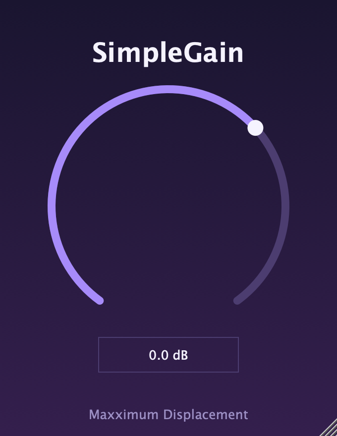
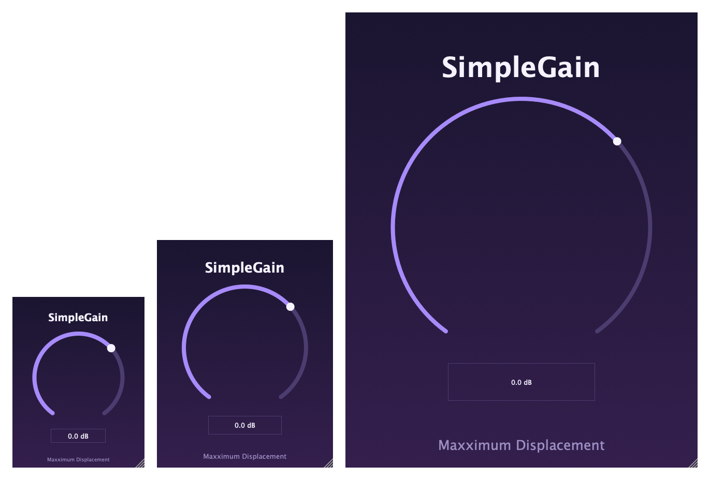
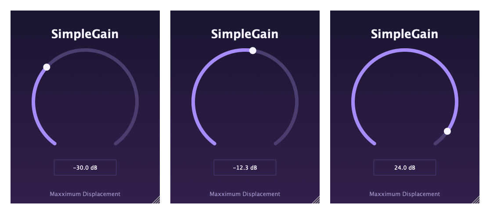

# The editor (GUI)

How the plugin window is built: what an editor is, how the knob is wired to the gain parameter
in both directions, why the order of member variables matters, and how a GUI gets tested with no
screen at all.

**SimpleGain docs** · [Index](README.md)  
**The plugin:** [Plan](plan.md) · [Hosting & threads](plugin-hosting-and-threads.md) · [Parameters & automation](parameters-and-automation.md) · [Smoothing & the audio loop](smoothing-and-the-audio-loop.md) · [State: save and restore](state-save-and-restore.md) · [Identity & macOS](plugin-identity-and-macos.md) · **The editor (GUI)**  
**C++ foundations:** [Memory model](cpp-memory-model.md) · [Build pipeline](cpp-build-pipeline.md) · [CMake walkthrough](cmake-walkthrough.md)  
**Workflow:** [Dev tooling](dev-workflow-and-tooling.md) · [Testing](testing.md) · [CI & GitHub Actions](ci-and-github-actions.md)

---

## In short

- **The editor is a `juce::Component`** — JUCE's base class for anything drawable, roughly WPF's
  `UIElement` or WinForms' `Control`. Components form a tree: the editor owns a title label and a
  knob.
- **It's separate from the processor and optional.** A host can run the plugin with no window,
  and opens and closes the window many times. The editor lives on the **message thread**;
  `processBlock` stays on the audio thread and never learns the editor exists.
- **`SliderAttachment` is a two-way binding**, the closest thing JUCE has to WPF data binding.
  Turn the knob and the parameter moves; the host automates the parameter and the knob moves.
  We write no listener code ourselves.
- **Member order is a correctness rule.** C++ destroys members in reverse order of declaration,
  and the attachment's destructor touches the slider, so the attachment is declared *after* the
  slider.
- **`paint()` draws, `resized()` positions.** JUCE calls both; we never do. Every size is a
  fraction of the window, so the whole layout scales.
- **The window resizes** between 75% and 200% of its opening size, always keeping its shape.
- **It's tested without a screen.** JUCE can build a component, lay it out and paint it into an
  image in memory. 10 tests cover it, and a `--snapshots` mode writes the PNGs on this page.
- **Nothing permanent changed.** The parameter id, range and saved format are untouched; the
  editor only *reads and writes* the parameter.



---

## 1. What an editor is

Until Phase 6 the plugin showed JUCE's `GenericAudioProcessorEditor`: an automatically generated
window with one slider per parameter. It works, but it looks like a debugging tool. Phase 6
replaces it with our own `SimpleGainAudioProcessorEditor`.

An editor is a **`juce::Component`**. Everything visible in a JUCE app is one: windows, buttons,
sliders, labels. Components nest, so the window is a tree:

```
SimpleGainAudioProcessorEditor     (the window)
├── titleLabel                     (a juce::Label)
└── gainSlider                     (a juce::Slider, which owns its own value text box)
```

| JUCE | WPF | WinForms |
|---|---|---|
| `juce::Component` | `UIElement` / `FrameworkElement` | `Control` |
| `addAndMakeVisible (child)` | adding to `Children` | `Controls.Add (child)` |
| `paint (Graphics&)` | `OnRender` | `OnPaint` |
| `resized()` | `ArrangeOverride` | `OnResize` / `Layout` |
| `juce::Slider` | `Slider` | `TrackBar` |

Two things differ from what a C# developer expects:

- **There's no designer and no markup.** The layout is code. For a window this size that's
  shorter than the XAML would be, and it's what almost every plugin does.
- **JUCE draws everything itself**, rather than asking the operating system for native buttons.
  That's why the plugin looks identical in Logic, Reaper and the Standalone app, and why we can
  paint a gradient background and a custom-coloured knob with a few lines.

---

## 2. The editor and the processor

The editor is **not** part of the processor, and the processor doesn't need it:

- A host can create the plugin and process audio without ever opening a window. Some never do.
- A host can open and close the window many times in one session. Each open creates a *new*
  editor (`createEditor()`) and each close destroys it. The processor, and its parameter, outlive
  all of them.
- The editor runs on the **message thread** (the GUI thread). `processBlock` runs on the audio
  thread. They share only the *parameter*, which is built for exactly that (see
  [Parameters & automation](parameters-and-automation.md)), so the editor never needs a lock the
  audio thread could wait on.

The constructor takes the processor **by reference**:

```cpp
explicit SimpleGainAudioProcessorEditor (SimpleGainAudioProcessor&);
```

A reference can't be null, and taking one says "I use this but don't own it". The processor
always outlives the editor, so there's nothing to delete. The base class
`AudioProcessorEditor` remembers the processor itself (as a member called `processor`), so we
don't keep a second copy. The tests don't touch that member: they find the knob by its ID instead.

`explicit` stops C++ from quietly converting a processor into an editor wherever one is
expected. C# has no direct equivalent because it has no implicit single-argument constructor
conversions; in C++ you opt out of them with `explicit`.

---

## 3. The knob and the title

```cpp
gainSlider.setSliderStyle (juce::Slider::RotaryHorizontalVerticalDrag);
gainSlider.setTextBoxStyle (juce::Slider::TextBoxBelow, false, 120, 28);
```

- **`RotaryHorizontalVerticalDrag`** draws a knob that you turn by dragging up/down *or*
  left/right. The other rotary style makes you drag in a circle, which is awkward with a mouse.
- **The text box** below the knob shows the value, and you click it to type a number. The
  `false` means it's *not* read-only. The width and height are placeholders: `resized()`
  replaces them with sizes proportional to the window.
- **Colours** come from the same purple palette as the README banner, set once in an anonymous
  namespace at the top of `PluginEditor.cpp`. `setColour` takes an *ID* (such as
  `rotarySliderFillColourId`) so each part can be styled separately.
- **`setComponentID ("gainSlider")`** gives the knob a name the tests can look it up by,
  without needing access to the editor's private members.
- **`setTitle ("Gain")`** is what a screen reader announces. It costs one line and makes the
  knob usable by people who can't see it.

Nothing here says *what the knob's range is*, or what text it shows. That comes from the
parameter, via the attachment in the next section.

---

## 4. The attachment: a two-way binding

This is the heart of the editor, and it's **one line**:

```cpp
gainAttachment (p.apvts, "gain", gainSlider)
```

`AudioProcessorValueTreeState::SliderAttachment` connects a slider to a parameter by id. After
it runs:

| Event | What happens |
|---|---|
| The knob starts | It's moved to the parameter's current value, not the default. |
| The user turns the knob | The parameter is set, and the host is told it's being edited, so a recording automation lane captures the movement. |
| The user double-clicks the knob | It resets to the parameter's default, 0 dB. |
| The user types `-12` in the box | It's parsed with the *parameter's* text rules and applied. |
| The host automates the parameter | The knob moves to match. |

The attachment also **replaces the slider's own range and text functions with the parameter's**.
That's why the box reads `−6.0 dB`, not `-6` — the text lambda from
[Parameters & automation](parameters-and-automation.md) is reused, and the knob covers
−60..+30 dB without our repeating those numbers in the editor. The range exists in exactly one
place.

**C# comparison.** This is WPF data binding with `Mode=TwoWay`:

```xml
<Slider Value="{Binding Gain, Mode=TwoWay}" Minimum="-60" Maximum="30" />
```

Same idea — the view and the model stay in sync without hand-written event handlers — but
here it's an object you construct, not markup, and it has to be kept *alive* for the binding to
hold (the next section).

**Threads.** The host may change the parameter from any thread, but a component may only be
touched on the message thread. The attachment handles this: if the change arrives on another
thread, it posts an asynchronous update and the knob moves on the message thread. We never
write that code ourselves — which is exactly why we use the attachment.

---

## 5. Member order matters

The members are declared in this order:

```cpp
juce::Label titleLabel;
juce::Slider gainSlider;
juce::AudioProcessorValueTreeState::SliderAttachment gainAttachment;
```

C++ **constructs members top to bottom in declaration order, and destroys them bottom to top**
— regardless of the order in the constructor's initialiser list. So here:

```
construct:  titleLabel → gainSlider → gainAttachment
destroy:    gainAttachment → gainSlider → titleLabel
```

That's right, because of what each part does:

- The attachment's *constructor* uses the slider, so the slider has to exist first.
- The attachment's *destructor* calls `slider.removeListener (this)`. If the slider were already
  gone, that would touch freed memory — a use-after-free, the bug described in
  [Memory model](cpp-memory-model.md).

Swap the two lines and it compiles without a warning. It may even run, until the editor is
closed. That's the nasty part: **nothing flags the mistake**, so the header carries a comment in
capitals and the tests open and close editors 50 times.

**C# comparison.** There's nothing like it. In C#, objects are never destroyed in a defined
order — the garbage collector decides — and you can't hold a dangling reference. In C++ the
order is defined and *you* are responsible for it. The same rule is why a `std::unique_ptr`
member is safe to declare next to the thing it owns: the destructors run in a known sequence.

---

## 6. `paint()`: drawing the background

```cpp
g.setGradientFill (juce::ColourGradient::vertical (backgroundTop, backgroundBottom, getLocalBounds()));
g.fillAll();
```

JUCE calls `paint` whenever part of the window needs redrawing: the first time, after a resize,
after something moves. **We never call it ourselves.** To ask for a redraw you'd call
`repaint()`, which schedules one.

`juce::Graphics` is the drawing context — WinForms' `Graphics`, or a WPF `DrawingContext`. The
editor paints only the background and the small credit line; **children paint themselves**, and
JUCE draws them on top afterwards. The knob and title aren't drawn here.

`paint` can run many times a second while the window is dragged, so it should be cheap and
shouldn't allocate much. Ours builds one gradient and one line of text.

The credit line's font size is `getHeight() * 0.035f`, a fraction of the window, so it scales
with everything else.

---

## 7. `resized()`: layout by carving up a rectangle

JUCE has no layout panels like WPF's `Grid` or `StackPanel`. The idiom is to hold a
`juce::Rectangle` and **slice pieces off it**:

```cpp
auto area = getLocalBounds().reduced (getWidth() / 12);          // margin all round

titleLabel.setBounds (area.removeFromTop (windowHeight / 9));    // title strip
area.removeFromBottom (windowHeight / 12);                       // room for the credit line
gainSlider.setBounds (area);                                     // the knob gets what's left
```

`removeFromTop (n)` *returns* the top `n` pixels **and shrinks `area`** by that much, so each line
takes its slice and the next sees what remains. `getLocalBounds()` is the component's own area
with its top-left at (0, 0); `getBounds()` would be relative to its parent.

JUCE calls `resized()` when the size first changes and on every later resize. Because every
number is a **fraction of the window** (a twelfth, a ninth), the layout works at any size
without special cases. Absolute pixel sizes would look right at one size and wrong at all the
others.

**Division is integer division** — `windowHeight / 9` drops the remainder. That's fine for pixel
positions, but it's why we divide *last*: `defaultWidth * 3 / 4`, not `defaultWidth * 0.75`
converted back. In C#, `int / int` behaves the same way, so this one will feel familiar.

---

## 8. Making the window resizable

```cpp
setResizable (true, true);
setResizeLimits (defaultWidth * 3 / 4, defaultHeight * 3 / 4, defaultWidth * 2, defaultHeight * 2);
getConstrainer()->setFixedAspectRatio (static_cast<double> (defaultWidth) / defaultHeight);
setSize (defaultWidth, defaultHeight);
```

- `setResizable (true, true)` lets the *host* resize the window and also adds a small drag
  handle in the bottom-right corner (the diagonal lines in the pictures).
- **The limits** are 75% to 200% of the opening size: 255×330 up to 680×880. Smaller than that
  and the text box stops being readable; larger is wasted on a single knob.
- **The fixed aspect ratio** keeps the window the same shape. A free-form resize would give a
  tall thin strip or a wide flat one, and the knob would have nowhere sensible to go.
- **`static_cast<double>`** matters: `defaultWidth / defaultHeight` is *integer* division and
  would give `0`. Casting one side first makes it a real division. (C# does the same with `int / int`, so
  there too you'd cast one side.)
- **`setSize` comes last**, after the limits are set, so the opening size is checked against
  them.



Not every host honours these limits (some plugin hosts fix the window size). The editor stays
correct either way, because `resized()` copes with whatever size it's handed.

**Known limitation.** The value text (`0.0 dB`) keeps JUCE's default 15-point font at every
size, so at the largest window it looks small next to the knob. Scaling it would mean giving the
slider a custom `LookAndFeel`, which is more machinery than this phase warrants. It's noted here
rather than hidden.

---

## 9. Wiring it in: `createEditor()`

The processor decides what window it shows:

```cpp
juce::AudioProcessorEditor* SimpleGainAudioProcessor::createEditor()
{
    return new SimpleGainAudioProcessorEditor (*this);
}
```

The host calls this each time it opens the window, and **takes ownership** of the returned
pointer: it deletes the editor when the window closes. That's one of the few places this
project uses a raw `new` — the pointer's lifetime is handed to the host by JUCE's contract, so
we don't wrap it. (`*this` is the processor itself; the `*` turns the pointer `this` into the
reference the constructor wants.)

`hasEditor()` returns `true`, which is what tells the host there's a window to show. Previously
`createEditor()` returned `new juce::GenericAudioProcessorEditor (*this)`; swapping that line is
the whole change. A test checks it hasn't been swapped back.

---

## 10. Testing a GUI with no screen

A common assumption is that GUIs can't be tested automatically. They can, as far as *behaviour*
goes, because a component doesn't need a window to exist. The 10 tests in
`tests/EditorTests.cpp` (group **Editor**, 103 checks) create the real editor and drive it:

| Test | What it proves |
|---|---|
| The plugin offers its own editor | `createEditor()` returns *our* editor, not JUCE's generic one |
| Opens inside its resize limits | The opening size and aspect ratio are consistent with the constrainer |
| The knob starts at the fader's position | A plugin reopened at −6 dB doesn't show 0 |
| Turning the knob moves the parameter | Knob → parameter, across the whole range |
| The host moves the parameter, the knob follows | Parameter → knob, across the whole range |
| The text box shows and accepts the right text | `−6.0 dB` out, `-12`, `-12 dB` and `+4.5` in |
| Range and double-click reset | −60..+30 and a 0 dB reset |
| Layout at every size | Nothing sticks out of the window at the minimum, opening and maximum sizes |
| It actually draws | The gradient and the knob are really in the image |
| Opening and closing | 50 open/close cycles, and the parameter moving while *no* editor exists |

The tests were **written first**. Against the old generic editor, 8 tests passed and 10 failed; then the editor made them
pass. Afterwards the editor was deliberately broken in ten ways to prove the tests notice, and all ten
were caught (see [Testing](testing.md#how-i-know-they-can-fail)). The first round caught only nine
of ten, and the one that survived, an invisible knob, led to a stronger "it draws" test.

What they *can't* prove is that it looks good, or feels good to drag. For that, there's a
**snapshot mode**:

```bash
cmake --build build --target SimpleGain_Tests
build/SimpleGain_Tests_artefacts/Debug/SimpleGain_Tests --snapshots some-folder
```

It builds the editor in memory, calls `createComponentSnapshot`, and writes PNGs — the three
pictures on this page come from it, so they show the real code, not a mock-up:



Still by hand: open the Standalone, turn the knob, type a value, double-click to reset, drag the
corner, and in a DAW check that automation moves the knob. Those need ears and a mouse.
