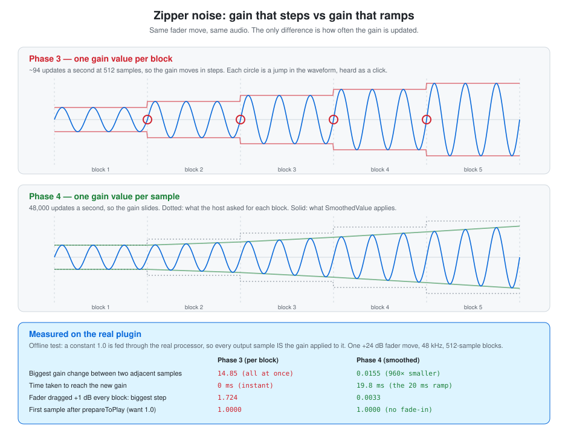

# Smoothing & the audio loop

How the gain stops clicking: why a fader move becomes zipper noise, how `juce::SmoothedValue`
fixes it, and the C++ you meet on the way — loop order, raw pointers, denormals and `float`.

**SimpleGain docs** · [Index](README.md)  
**The plugin:** [Plan](plan.md) · [Hosting & threads](plugin-hosting-and-threads.md) · [Parameters & automation](parameters-and-automation.md) · **Smoothing & the audio loop** · [State: save and restore](state-save-and-restore.md) · [Identity & macOS](plugin-identity-and-macos.md) · [The editor (GUI)](editor-gui.md)  
**C++ foundations:** [Memory model](cpp-memory-model.md) · [Build pipeline](cpp-build-pipeline.md) · [CMake walkthrough](cmake-walkthrough.md)  
**Workflow:** [Dev tooling](dev-workflow-and-tooling.md) · [Testing](testing.md) · [CI & GitHub Actions](ci-and-github-actions.md)

---

## In short

- **Zipper noise** is a staircase of tiny clicks. Phase 3 read the fader once per block and used
  that one value for every sample in it, so dragging the fader became steps — and a step in the
  gain is an abrupt jump in the waveform, which the ear hears as a click.
- **`juce::SmoothedValue`** fixes it by gliding to the new gain over 20 ms, one small step per
  *sample*. Measured on the real plugin: the biggest change between two adjacent samples fell
  from **14.85 to 0.0155** for a +24 dB move.
- **Start it at the right value.** `reset()` leaves it at 0, so without
  `setCurrentAndTargetValue(...)` every playback start would fade in from silence.
- **Samples outer, channels inner.** The smoother is stateful, so the gain must advance once per
  *sample* and be shared by every channel. The wrong order leaves the right channel half-way
  through a different part of the ramp.
- **`isSmoothing()` fast path.** Most of the time the fader isn't moving, and a steady gain is
  one vectorised multiply. The per-sample loop only runs during the 20 ms glide.
- **`juce::ScopedNoDenormals`** is an RAII guard that stops denormal floats stalling the CPU,
  and audio uses `float`, not `double`.

---

## 1. What zipper noise is, and why a step makes a click

Audio is a waveform, and the ear hears an abrupt change in a waveform as a click — a very short
burst of every frequency at once. Multiplying audio by a gain that changes instantly between two
adjacent samples *creates* exactly that kind of abrupt change, even if the audio itself was
perfectly smooth.

Phase 3 made it happen like this. `processBlock` read the fader **once per block** and applied
that single value to every sample in the block. Drag the fader and the gain moves in a
**staircase** — about 94 steps a second at 512 samples. A stream of small clicks at that rate
isn't heard as clicks any more; it's heard as a buzzing, gritty texture. The name comes from the
sound.



The diagram's numbers aren't illustrative. I fed a constant `1.0` through the real processor,
so every output sample *is* the gain applied to it, and measured the largest change between two
adjacent samples after a single +24 dB fader move (a gain change of 14.85):

| Sample rate / block | Phase 3 (per block) | Phase 4 ideal step | Phase 4 measured | Settles within 1% in |
|---|---|---|---|---|
| 48 kHz / 512 | 14.849 | 0.01547 | 0.01547 | 19.79 ms |
| 48 kHz / 64 | 14.849 | 0.01547 | 0.01547 | 19.79 ms |
| 96 kHz / 512 | 14.849 | 0.00773 | 0.00821 | 19.79 ms |
| 44.1 kHz / 256 | 14.849 | 0.01684 | 0.01695 | 19.80 ms |

Two things to notice:

- **Phase 3's step is the whole change, at every setting.** The block size and sample rate make
  no difference, because the whole move happens at one block boundary.
- **Phase 4's step is the change divided by the number of samples in 20 ms** — 960 at 48 kHz,
  1,920 at 96 kHz. That's the "ideal" column.

The measured step at 96 kHz is about 6% above ideal. I checked why: the *median* step equals the
ideal step exactly, and the largest one is always the **final sample of the ramp**. That's where
the smoother snaps onto the exact target, absorbing the float rounding error accumulated over
1,920 additions. Every step is ideal except that landing. It's a small, concrete example of why
accumulating in `float` is not free (see §8).

---

## 2. How `SmoothedValue` works

Three calls do the job:

```cpp
smoothedGain.reset (sampleRate, 0.02);       // ramp length: 20 ms, converted to samples
smoothedGain.setTargetValue (newGain);       // "head for this" — once per block
const auto gain = smoothedGain.getNextValue();   // the gain for THIS sample — once per sample
```

Inside, it holds a current value, a target, and a countdown. `setTargetValue` sets the countdown
to the ramp length and works out the step size; each `getNextValue()` moves one step and counts
down. When the countdown reaches zero it lands on the target. All of this is in
`juce_SmoothedValue.h`, which I read rather than assumed.

**Details worth knowing**

- **Calling `setTargetValue` every block is free.** If the value equals the current target it
  does nothing, so a steady fader doesn't restart the ramp.
- **A new target restarts the ramp from wherever the value is now.** While the fader is moving
  continuously the smoother is always chasing it, so it lags by up to 20 ms. That's the solid
  line trailing the dotted one in the diagram, and it's imperceptible for a gain control.
- **The ramp is 20 ms of real time at any sample rate**, because `reset` takes the sample rate:
  960 samples at 48 kHz, 882 at 44.1 kHz, 1,920 at 96 kHz.
- **It doesn't depend on the host's block size.** The simpler alternative, `AudioBuffer`'s
  `applyGainRamp`, ramps over the samples you pass it — typically one block — so its ramp would
  be 1.3 ms at 64 samples and 10.7 ms at 512 (see [Hosting & threads §8](plugin-hosting-and-threads.md#8-samples-vs-blocks)).
  `SmoothedValue` keeps the 20 ms constant and carries the glide across several blocks.
- **Why 20 ms:** long enough that each step is tiny, short enough to feel immediate. It's a
  common choice rather than a magic number.

### Linear or multiplicative?

`SmoothedValue` has two modes. **Linear** moves in equal steps of *amplitude*. **Multiplicative**
multiplies by the same ratio each step, which is a straight line in **dB**. JUCE's own header
says multiplicative is *"useful when you are dealing with exponential/logarithmic values like
volume in dB"*, and our parameter is exactly that.

The plan specified Linear, so that's what the code uses. Here's what the two actually do to the
loudness over a 20 ms glide (measured; a perfectly even glide would hit 10% / 50% / 90% of the
way at the same fractions of the dB change):

| Move | Mode | 10% through | 50% through | 90% through |
|---|---|---|---|---|
| 0 → +24 dB | **Linear** | +7.91 dB | +18.51 dB | +23.15 dB |
| | Multiplicative | +2.40 dB | +12.00 dB | +21.60 dB |
| 0 → −60 dB | **Linear** | −0.91 dB | −6.01 dB | −19.92 dB |
| | Multiplicative | −6.00 dB | −30.00 dB | −54.00 dB |

Neither clicks — both move in tiny steps. But Linear is lopsided in dB, which is how loudness is
heard: pulling the fader to the bottom stays within 6 dB of full volume for half the glide, then
drops the last ~40 dB in about 2 ms. Multiplicative would give an even slide. At 20 ms the
audible difference is probably small, and I haven't compared them by ear. Switching is a
one-word change (`Linear` → `Multiplicative`); it can't ever reach exactly 0, which is fine here
because our minimum is −60 dB, a gain of 0.001.

---

## 3. Starting from the right value

A default-constructed `Linear` `SmoothedValue` **starts at 0**, and `reset()` snaps the current
value to the *existing target* — so after `reset` alone the gain is 0. The first
`setTargetValue(1.0)` would then glide 0 → 1 over 20 ms: a **fade-in on every playback start**.
The host calls `prepareToPlay` before playback starts and again whenever the sample rate or
block size changes, so this wouldn't be a one-off.

```cpp
smoothedGain.reset (sampleRate, gainRampSeconds);
smoothedGain.setCurrentAndTargetValue (juce::Decibels::decibelsToGain (gainDbParameter->load()));
```

The second line starts the smoother *at the fader's real position*. It reads the parameter
rather than hard-coding 1.0, because a loaded project can have the fader anywhere when
`prepareToPlay` is called. Measured: the first sample after `prepareToPlay` is exactly `1.0000`.

The C# parallel is a constructor that leaves a field at `default(float)`. The type is valid and
compiles; it's just 0 when you wanted something else.

---

## 4. The loop: samples outer, channels inner

```cpp
for (int sample = 0; sample < numSamples; ++sample)
{
    const auto gain = smoothedGain.getNextValue();       // advance ONCE per sample

    for (int channel = 0; channel < numChannels; ++channel)
        channels[channel][sample] *= gain;               // same gain for every channel
}
```

The smoother is **stateful**: every `getNextValue()` call advances it. The gain should depend on
*when* a sample happens, not on which channel it's in, so it must advance once per sample-time
and be shared.

### The classic bug

Swap the loops — channels outer, samples inner, with the one shared smoother — and channel 0
uses up the entire block's worth of ramp steps. Channel 1 then carries on from where channel 0
stopped. I measured it (512-sample block, 48 kHz, +24 dB move):

| | First sample's gain | Biggest step inside the block |
|---|---|---|
| Channel 0 | 1.0155 (correct) | 0.0155 |
| Channel 1 | **8.9349** | 0.0155 |

Channel 1 starts the block already 512 steps into the ramp. Inside the block each channel looks
smooth, which is what makes this bug sneaky — the damage is that **left and right disagree on
all 512 samples** (so the stereo image swings), and channel 1 jumps by about 7.9 at the block
boundary. With a block of 960 samples or more, channel 1 would get no smoothing at all and take
the full jump at once.

The correct loop passed the same test cleanly: channel 0 and channel 1 were identical on every
sample, at every sample rate and block size I tried.

---

## 5. The fast path: `isSmoothing()`

```cpp
smoothedGain.setTargetValue (juce::Decibels::decibelsToGain (gainInDecibels));

if (smoothedGain.isSmoothing())
    { /* the per-sample loop from §4 */ }
else
    buffer.applyGain (smoothedGain.getTargetValue());
```

`isSmoothing()` is true while the countdown is above zero. Most of the time the fader isn't
moving, the gain is constant, and `applyGain` multiplies each channel's array in one go — the
shape of work a CPU is best at. The slower per-sample loop only runs for the 20 ms after a
change. Both branches give the same answer when the gain is steady, because `getNextValue()`
just returns the target once smoothing has finished.

**The order matters:** `setTargetValue` goes *first*, so a change that arrives in this block
makes `isSmoothing()` true in this block. A ramp that finishes partway through a block is handled
inside the loop, since `getNextValue()` starts returning the target.

---

## 6. Raw pointers: `getArrayOfWritePointers` and `channels[channel][sample]`

`AudioBuffer` stores audio **planar** — one separate `float` array per channel (see
[Hosting & threads §6](plugin-hosting-and-threads.md#6-planar-vs-interleaved)).

```cpp
auto* const* channels = buffer.getArrayOfWritePointers();
```

That returns a `float* const*`. Read it right to left: *a pointer to a constant pointer to a
float* — an array of channel pointers, where the pointers themselves can't be reseated but the
floats they point at can be written. `auto* const*` mirrors the same shape.

**`channels[channel][sample]`** is two steps: the first index picks that channel's pointer; the
second indexes into the array it points at. For a pointer `p`, `p[i]` means exactly
`*(p + i)` — move `i` floats (`i × 4` bytes) along from `p`, then read what's there. That's
**pointer arithmetic**, and it's all array indexing is in C++.

**Compared with C#**

| | C# | C++ here |
|---|---|---|
| Shape | `float[][]` (jagged array) | `float* const*` |
| Bounds checking | yes — `IndexOutOfRangeException` | **none** — reading `channels[0][numSamples]` reads whatever memory follows, silently |
| Ownership | the array owns its data | a **view** into the host's memory; we never free it |

The nearest modern C# analogue is a `Span<float>` over memory you don't own.

**Why not `buffer.getSample(c, i)` inside the loop?** It does extra checks on every call.
Fetching the pointers once, outside the loop, leaves the inner loop as plain array indexing.
The price is that nothing stops `channel` or `sample` running past the end. Here both are
bounded by the buffer's own `getNumChannels()` and `getNumSamples()`.

Pointers and references in general: [Memory model §2](cpp-memory-model.md#2-references-vs-pointers-the-callers-object-and-in-place).

---

## 7. Denormals and `ScopedNoDenormals`

A **denormal** (or *subnormal*) is a float closer to zero than the smallest "normal" one, about
1.2 × 10⁻³⁸ for a 32-bit float. The format gives up precision to represent these tiny values,
and many CPUs handle them through a slow path — dramatically slower than normal arithmetic.

They appear where signals decay toward silence: reverb and filter tails, feedback loops, long
fades. **SimpleGain's single multiply makes very few of its own**, so for this plugin it's
mostly a defensive habit — but a plugin often receives them from whatever sits before it on the
track, and it's the first thing to add once the DSP involves feedback.

```cpp
juce::ScopedNoDenormals noDenormals;
```

I read what it does in JUCE's source: the constructor **sets the CPU's flush-to-zero bits** (in
the SSE control register on Intel, the `FZ` bit on Arm) and remembers the old value; the
destructor puts it back. Until the end of `processBlock`, denormals count as zero.

That makes it **RAII** again — the same idea as C#'s `using`, but automatic (see
[Memory model §4](cpp-memory-model.md#4-destructors-and-why-c-needs-a-gc-but-c-doesnt)). The
object does nothing visible after construction; the *constructor and destructor are the whole
point*. Two consequences:

- **It must be named.** `juce::ScopedNoDenormals();` with no variable name creates a temporary
  that is destroyed at the end of that very statement, so the flag would be set and cleared
  instantly. The variable `noDenormals` is never read, and it still has to exist.
- **It's restored however the scope exits**, including early returns.

---

## 8. Why `float`, not `double`

Audio buffers are 32-bit `float`. A float carries 24 significant bits, worth about **144 dB** of
range (roughly 6 dB per bit) — more than any converter can deliver. It also halves memory
traffic, and a CPU can process twice as many floats per instruction as doubles, which matters
when `processBlock` has a few milliseconds.

`AudioProcessor` lets a plugin opt in to double-precision buffers through
`supportsDoublePrecisionProcessing()`; I checked, and the default is `false`. We don't override
it, so hosts hand us `float`.

**Where `double` still earns its place:** anything that accumulates or recurses, where rounding
error compounds. §1 showed a small case — adding a step 1,920 times in `float` left an error
that surfaced as the final landing step. It's why the *time* values here (`sampleRate`,
`gainRampSeconds`) are `double`: they're not audio, and the precision is free.

**A pitfall:** in C++ a literal like `0.5` is a `double`, and `x * 0.5` with a `float x` quietly
does the maths in double. C# has the same literal rule but refuses to narrow the result back
without a cast; C++ does it silently. The strict warning flags (`-Wconversion`, see
[CMake walkthrough §7](cmake-walkthrough.md#7-target_link_libraries--private-public-and-the-flag-targets)) catch the narrowing, so a warning-free build means none slipped in.

---

## 9. Checking it yourself

**Measuring.** The numbers above came from a throwaway offline harness: it drives the real
`SimpleGainAudioProcessor` with no DAW and no sound card, feeds it a constant `1.0`, changes the
`gain` parameter, and records what comes out. It measures the *shape of the gain curve*, which is
what causes zipper noise — not how anything sounds. It isn't part of the repo.

**Listening.** Zipper noise needs a **sustained, steady** signal to be audible; speech masks it.

1. Build **Release** — see [CMake walkthrough §8](cmake-walkthrough.md#8-debug-vs-release--and-why-it-matters-for-audio).
2. Put SimpleGain on a track in a DAW, looping a held pad or a sine tone. (Standalone works too,
   routed through BlackHole — [Testing](testing.md#1-how-do-you-actually-test-a-gain-plugin-standalone).)
3. Drag the gain fader quickly. Phase 3 should sound stepped or gritty; Phase 4 should slide.

To hear the difference directly, build the commit before Phase 4 and compare.
