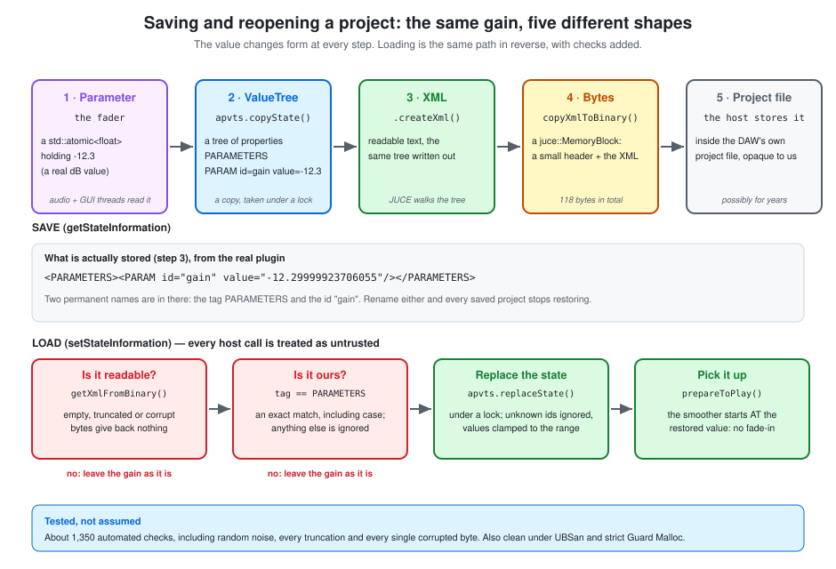

# State: save and restore

How the gain survives closing and reopening a project: what a host actually stores, the path
from a fader to a few bytes in a project file, and why loading has to treat those bytes as
untrusted.

**SimpleGain docs** · [Index](README.md)  
**The plugin:** [Plan](plan.md) · [Hosting & threads](plugin-hosting-and-threads.md) · [Parameters & automation](parameters-and-automation.md) · [Smoothing & the audio loop](smoothing-and-the-audio-loop.md) · **State: save and restore** · [Identity & macOS](plugin-identity-and-macos.md)  
**C++ foundations:** [Memory model](cpp-memory-model.md) · [Build pipeline](cpp-build-pipeline.md) · [CMake walkthrough](cmake-walkthrough.md)  
**Workflow:** [Dev tooling](dev-workflow-and-tooling.md) · [Testing](testing.md) · [CI & GitHub Actions](ci-and-github-actions.md)

---

## In short

- **State is whatever bytes the plugin hands the host when a project is saved.** The host
  stores them, untouched and unread, and gives them back when the project reopens. The format is
  entirely ours.
- **The path:** parameter → `ValueTree` → XML → bytes. For our single parameter that's
  **118 bytes**.
- **C++ has no reflection**, so nothing is saved automatically. `AudioProcessorValueTreeState`
  can do it only because every parameter was *registered* up front.
- **Loading is the dangerous half.** Those bytes come out of a file that might be corrupt,
  truncated, from another plugin, or from a different version. The plugin must never crash on
  them: a crash while loading means the user's project won't open, and the plugin gets blamed.
- **The restored gain is picked up by `prepareToPlay`**, so it applies from the very first
  sample with no fade-in. That's the Phase 4 smoother being initialised properly, paying off.
- **`copyState()` and `replaceState()` take locks.** They're thread-safe but not real-time-safe,
  so they never go anywhere near `processBlock`.
- **Two names are permanent:** the document tag `PARAMETERS` and the parameter id `gain`. Tests
  lock them, because renaming either silently stops every saved project restoring.

---

## 1. What "state" is, and who owns it

When a user saves a project, the DAW asks every plugin in it for its state by calling
`getStateInformation`. When the project reopens, it creates a fresh instance of the plugin and
hands that same data back through `setStateInformation`. The host never looks inside: to it, the
state is an opaque blob of bytes. **We decide the format, and we're the only thing that can read
it.**

Hosts also call these for preset saves, duplicating a plugin, and some undo systems, so they can
be called more often than you'd expect.

State is **not the same thing as parameters**, though ours happens to contain only parameters.
Parameters are what the host can see and automate. State is *everything needed to recreate the
plugin as the user left it* — which for a more complex plugin might also include a window size, a
selected preset name, or sample file paths. The `ValueTree` we use can hold any of that alongside
the parameters.

**The Standalone app uses the same two functions.** JUCE's standalone wrapper calls
`getStateInformation` when you quit, stores the result as base64 text under the name
`filterState` in the app's settings file, and feeds it back to `setStateInformation` on launch.
That's why "set a gain, quit, relaunch" is a real test of this code.

---

## 2. The path: parameter → `ValueTree` → XML → bytes



```cpp
void SimpleGainAudioProcessor::getStateInformation (juce::MemoryBlock& destData)
{
    if (const auto xml = apvts.copyState().createXml())
        copyXmlToBinary (*xml, destData);
}
```

Five shapes, one value:

1. **The parameter** is a `std::atomic<float>` holding the real dB value.
2. **`apvts.copyState()`** takes a snapshot of every parameter's current value and returns it as
   a `ValueTree`. It flushes any pending changes first, and returns a *copy*, so nothing else can
   change it while we work.
3. **`.createXml()`** writes the tree out as XML. It returns a `std::unique_ptr`, which is empty
   if there's nothing to write — hence the `if (const auto xml = ...)`.
4. **`copyXmlToBinary`** wraps the XML in a small binary envelope (see §5).
5. **The host** stores those bytes inside the project file.

This is what's actually stored, captured from the real plugin by the "saved format" test, with
the fader at −12.3 dB:

```xml
<?xml version="1.0" encoding="UTF-8"?> <PARAMETERS><PARAM id="gain" value="-12.29999923706055"/></PARAMETERS>
```

Two things stand out. The value is the **real dB number**, not a normalised 0–1 fraction — so a
saved fader position survives a change of range (see §9). And it's `-12.29999923706055` rather
than `-12.3`: the parameter is a 32-bit `float`, which has no exact representation of −12.3, and
the XML writes out the float's true value. It's the same `float` precision story as the landing
step in [Smoothing & the audio loop §8](smoothing-and-the-audio-loop.md#8-why-float-not-double).

---

## 3. `ValueTree`: JUCE's tree of properties

A `juce::ValueTree` is a node with three things: a **type** (here `PARAMETERS`), a set of named
**properties**, and **child nodes**. Our tree is a root of type `PARAMETERS` with one child of
type `PARAM`, whose properties are `id` and `value`.

It's JUCE's universal "bag of structured settings" type. It converts to and from XML
(`createXml`, `fromXml`), can be listened to for changes, and is what `AudioProcessorValueTreeState`
keeps in sync with the parameters.

**For a C# developer**, think of an `XElement` tree, or a JSON DOM. The reference behaviour even
matches: a `ValueTree` variable is a *handle* onto a shared node, like a C# reference, so
`auto b = a;` makes both refer to the **same** node. `createCopy()` is the deep copy, like
`new XElement(existing)`. That's exactly why `copyState()` ends in `state.createCopy()`: it hands
back a snapshot nobody else can modify.

One limit worth knowing: **a `ValueTree` has no equivalent of XML text nodes.** JUCE asserts if
you try to convert one (more on that in §6).

---

## 4. Serialisation without reflection

In C#, saving an object is one line, because the runtime can *look inside it*:

```csharp
var json = JsonSerializer.Serialize(settings);   // reflection: finds every property at run time
```

C++ can't. A compiled C++ program has no runtime record of what members a class has, so there is
nothing for a serialiser to inspect. State has to be **described explicitly**.

`AudioProcessorValueTreeState` can do it for us only because every parameter was *registered* up
front in `createParameterLayout()`. That registry is the schema. The practical consequence is
that **anything not registered isn't saved**: if a later version adds a `bool bypassed` member to
the processor, nothing about it will be stored until it's added to the tree on purpose.

---

## 5. `MemoryBlock`: a raw byte buffer

`getStateInformation` receives a `juce::MemoryBlock&` — an empty, growable buffer of raw bytes
that we fill in. It owns its memory and frees it automatically (RAII, see
[Memory model §4](cpp-memory-model.md#4-destructors-and-why-c-needs-a-gc-but-c-doesnt)). The
nearest C# idea is a `byte[]` or a `MemoryStream`, and the **out-parameter** pattern — the caller
supplies the object, the callee fills it — is the C# `out`/`ref` idea.

`copyXmlToBinary` writes a small envelope; I confirmed the layout from JUCE's source:

| Bytes | Content |
|---|---|
| 4 | a magic number, `0x21324356`, so it can recognise its own data |
| 4 | the length of the XML text |
| 109 | the XML text itself (UTF-8, on one line) |
| 1 | a closing zero byte |

That's the 118 bytes. Loading is the reverse, and note the signature:

```cpp
void setStateInformation (const void* data, int sizeInBytes)
```

A bare pointer and a separate length — what C#'s `ReadOnlySpan<byte>` bundles into a single safe
value. **Nothing ties the two together or checks them**, which is the first reason loading has to
be defensive.

---

## 6. Loading: never trust the bytes

```cpp
void SimpleGainAudioProcessor::setStateInformation (const void* data, int sizeInBytes)
{
    if (const auto xml = getXmlFromBinary (data, sizeInBytes))
        if (xml->getTagName() == apvts.state.getType().toString())
            apvts.replaceState (juce::ValueTree::fromXml (*xml));
}
```

The bytes come out of a project file. They might be empty, cut short by a bad save, scrambled by
disk or sync trouble, written by a *different* plugin, or written by an older or newer version of
this one. A crash here means **the user's project won't open**, and the plugin takes the blame.
So every step is a gate:

| Gate | What gets through | What happens otherwise |
|---|---|---|
| `getXmlFromBinary` | well-formed data of the right length with our magic number | returns nothing: empty, truncated, wrong-magic or non-XML data is ignored |
| exact tag match | a document whose root is `PARAMETERS` | someone else's document is ignored |
| `replaceState` | `PARAM` entries whose `id` is one we know | unknown ids are ignored |
| value handling | numbers inside the parameter's range | out-of-range values are clamped (`999` → `+30`, `-999` → `-60`) |
| missing entries | — | a parameter absent from the saved state returns to its **default** |

### What testing turned up

I wrote these tests *before* the implementation, then ran them against the empty stubs: 60 checks
passed and 10 failed, all in the state tests. Implementing the two functions turned them green,
but the hostile-input tests found things I hadn't predicted:

- **I was wrong about missing parameters.** I assumed a saved state that omitted `gain` would
  leave it where it was. It resets it to the default. That's the better behaviour: a project saved
  *before* a parameter existed gets the default for it, instead of inheriting whatever the previous
  state left behind. The tests now assert the real behaviour.
- **JUCE's `hasTagName` ignores case — and asserts when the case differs.** XML tags are
  case-sensitive, and JUCE says so in a comment. One flipped bit turns `P` (`0x50`) into `p`
  (`0x70`), so a corrupt file can reach this. In a Release build it would quietly accept
  `parameters` as ours. The code now compares the tag exactly, and a test locks that in.
- **JUCE fires its own debug assertions on corrupt data**, from three places: invalid UTF-8 in
  `String::fromUTF8`, invalid attribute names in the XML parser, and XML text nodes in
  `ValueTree::fromXml`. They exist only in Debug builds. The tests catch and count them (667 per
  run) rather than burying the output in noise, but they still let through any assertion raised
  by *our own* code.
- **The "Release is unaffected" part is checked, not assumed** — see §10.

---

## 7. When loading happens: before playback, or during it

Hosts normally call `setStateInformation` **before** `prepareToPlay`, when a project opens. Our
`prepareToPlay` then reads the parameter and starts the smoother *at that value*:

```cpp
smoothedGain.setCurrentAndTargetValue (juce::Decibels::decibelsToGain (gainDbParameter->load()));
```

That line is why a restored gain applies from the very first sample. Had `prepareToPlay` assumed
unity, the restored gain would either jump or fade in. It's the payoff for the care taken in
[Smoothing & the audio loop §3](smoothing-and-the-audio-loop.md#3-starting-from-the-right-value),
and there's a test for it.

Loading can also happen **during playback** — recalling a preset, or an undo. Then the smoother
does what it always does: it glides to the new value over 20 ms instead of jumping. That has a
test too.

---

## 8. Threads and locks

JUCE documents that both `copyState()` and `replaceState()` **use locks**: thread-safe, but *not
real-time-safe*. Its own words: *"Do not call this method from within your audio processing
code!"*

That's the rule from [Hosting & threads](plugin-hosting-and-threads.md#3-what-is-a-thread-and-what-does-must-never-block-mean)
in action. Hosts call the state functions off the audio thread, so a lock is fine there, and
`processBlock` never touches them. The two sides meet at the parameter itself: `replaceState`
updates the `std::atomic<float>` that `processBlock` reads, with no lock involved on the audio
side.

---

## 9. What's permanent, and what changing it breaks

| Permanent | Why |
|---|---|
| the root tag `PARAMETERS` | the name passed to the `AudioProcessorValueTreeState` constructor; the exact-match check rejects anything else |
| the parameter id `"gain"` | it's the `id` stored in every saved project |
| the `PARAM` / `id` / `value` names | JUCE's, not ours — but they're in every saved file |

A test records today's format as a literal XML string and checks it still loads. **If that test
ever has to change, saved projects have broken.** Others lock the id, its version hint, and the
range.

How common changes behave:

- **Adding a parameter later:** older projects don't mention it, so it gets its default. Tested.
- **Removing one, or renaming its id:** the old entry becomes an unknown id and is silently
  ignored, so users lose that setting. Renaming is data loss; keep the old id.
- **Narrowing a range:** saved state holds the real dB value, so a value outside the new range is
  clamped. (Recorded *automation* behaves differently — see
  [Parameters & automation §3](parameters-and-automation.md#3-choosing-the-range-why-60-to-30-db).)
- **Changing what `value` means:** the state has no version number of its own. If that ever
  happens, adding one — `<PARAMETERS version="2">` — is the way to migrate. It isn't needed yet.

The `ParameterID` version hint (`juce::ParameterID { "gain", 1 }`) is a different thing: it tells
AU and VST3 hosts about a parameter's version. It isn't a schema version for the saved state.

---

## 10. Checking it

**Automated.** `tests/StateTests.cpp` covers the round trip, applying from the first sample,
loading during playback, wrong or unexpected documents, and the saved format.
`tests/CorruptStateTests.cpp` is the hostile-input test, in a group of its own so it can be run on
its own. It feeds the loader:

- empty, null and negative-size input, and 1-byte input
- random noise of five different lengths
- the valid state **truncated at every possible length**, in a block exactly that long, and again
  with a multi-byte UTF-8 lead byte as its last byte
- the valid state with **every single byte corrupted**, repeated across 8 fixed seeds

The seeds are fixed, so every run — and CI — corrupts the same bytes the same way. How to run
them, and how I know they can fail: [Testing §2](testing.md#2-automated-tests).

**Memory safety.** "It didn't crash" isn't the same as "it didn't read memory it shouldn't", so the
same inputs were run three more ways:

- **UBSan**, in a Release build where JUCE's assertions are compiled out: 1,356 checks, 0 reports.
- **Guard Malloc in strict mode** on the corrupt-data group: 1,288 checks, no faults. In this
  mode every allocation ends exactly at an unmapped guard page, so a read or write even one byte
  past the end faults at once. The truncated inputs live in exact-size blocks, and the last byte
  is set to each kind of multi-byte UTF-8 lead byte, which is the case a sloppy decoder reads past
  the end on. To check the mode can catch anything, I pointed it at a deliberate one-byte
  over-read in a throwaway program: it faulted immediately, where plain `malloc` and Guard
  Malloc's default mode both let it through.
- **AddressSanitizer** isn't usable on this machine: even a three-line program crashes with it at
  startup. That's a limitation of this setup, not a finding about the plugin, so there's no ASan
  claim here.

These were one-off checks and aren't part of the repo or CI.

**By hand.** The Standalone is the quickest real check: set a gain, quit the app, relaunch it, and
confirm the gain came back. In a DAW, set a gain, save the project, close and reopen it.
